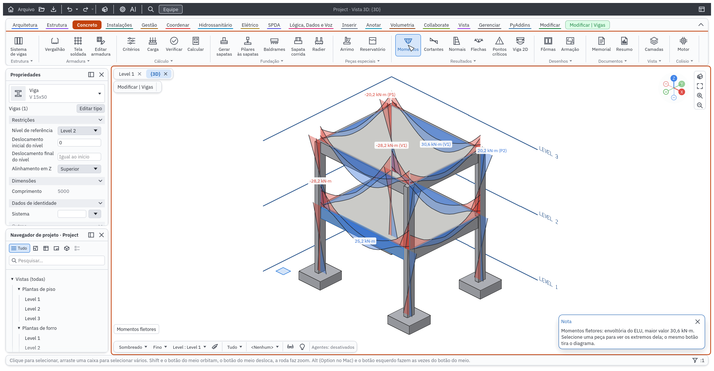
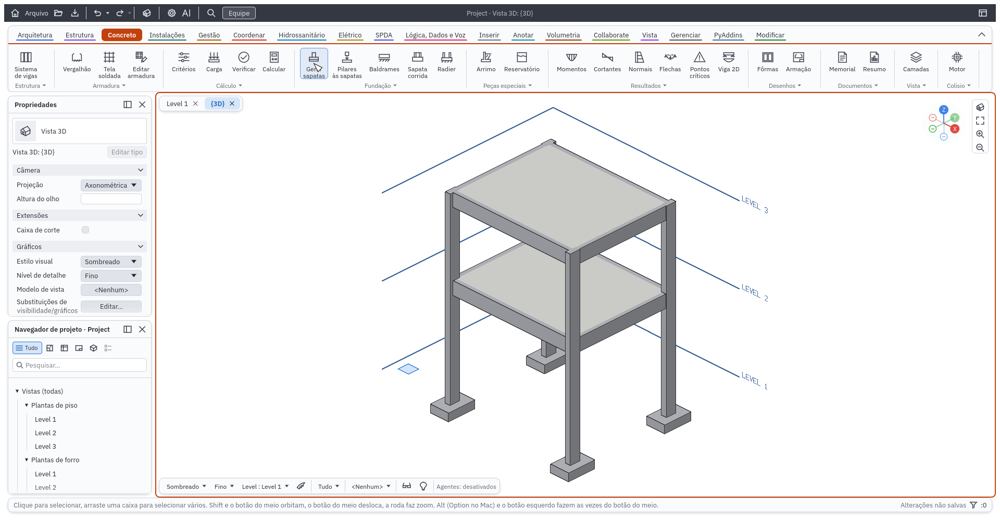
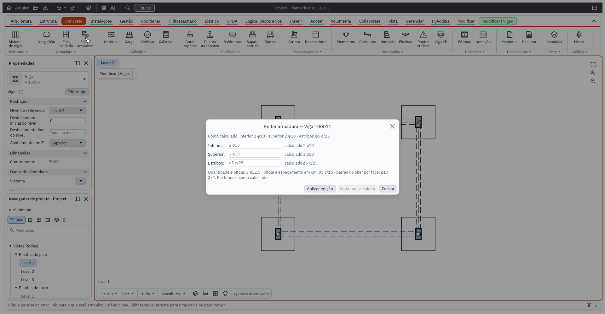
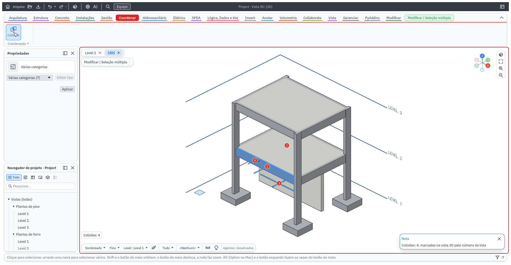

# Colisio

**Desktop BIM for building design in Brazil: architecture, reinforced-concrete analysis and detailing, building systems,
quantities and budget, drawings and coordination, in one model.**

-0078d4)

> **Language and codes.** The interface is in **Brazilian Portuguese** or **English** (File → Settings → Interface). The
> calculations follow the Brazilian **ABNT NBR** standards, so drawings, sheets and calculation reports come out in
> Portuguese. Button names on this page are the Portuguese ones, as the screenshots show them.

---

## Contents

- [Colisio 1.0](#colisio-10)
- [Highlights](#highlights)
- [Download and install](#download-and-install)
- [Updates](#updates)
- [Screenshots](#screenshots)
- [The Colisio's tabs](#the-colisios-tabs)
- [Projects of Colisio 1.9](#projects-of-colisio-19)
- [AI assistants and scripts](#ai-assistants-and-scripts)
- [License, third-party software and trademarks](#license-third-party-software-and-trademarks)

---

## Colisio 1.0

Colisio 1.0 is a new program: a full BIM modeller with a Revit-style workflow, and inside it everything Colisio
calculates and draws: the concrete structure, the building systems, the budget and the sheets. Its projects are
`.colisio` files of a new kind.

The earlier program, Colisio 1.9, is still available (see [Projects of Colisio 1.9](#projects-of-colisio-19)).

## Highlights

- **One model, every discipline.** Architecture, structure and building systems share the same levels, grids and views:
  plans, ceiling plans, sections, elevations, 3D views, schedules and sheets with title blocks.
- **A familiar workflow.** A ribbon with a colour for each tab, the Modify tab in context, two-letter shortcuts, the
  Properties palette and the Project Browser, alignment guides while drawing, phases and design options.
- **Concrete structure, analysed and detailed.** Criteria by NBR 6118, loads drawn on the plan or put on the pieces, the
  frame analysed and the pieces designed, and the results drawn over the 3D view: bending moments, shear, axial forces,
  deflections and critical points. Beam systems on slabs, footings generated from the analysis, columns taken down to
  them, tie beams, strip footings, rafts, retaining walls and water tanks. Reinforcement in 3D, with an editor for each
  piece, bars and welded mesh placed by hand, formwork and reinforcement sheets and the calculation report.
- **Building systems, designed.** Cold and hot water, sewer and inspection boxes, storm water, gas, fire protection and
  sprinklers, electrical (points, conduits and panels), communications, lightning protection and air conditioning, each
  sized by its Brazilian standard, with its memorial and its sheets. Runs are drawn in Colisio's systems with market pipe types, the
  system's height and slope, and tees where they join; fittings are listed and drawn as parts. Runs are routed around
  clashes, holes through beams are checked by NBR 6118, and risers are embedded in the walls.
- **Coordination.** Clash detection of the systems against the structure, the architecture and each other, with
  numbered markers in the 3D view. IFC import and export, Revit files read, DWG and DXF drawings and point clouds.
- **Quantities and budget.** Quantities taken from the model and a budget priced by the SINAPI of the project's state,
  with the reports and descriptive memorials.
- **Learn by doing.** *Aprender a projetar* (Gestão → Ajuda): 9 tracks and 66 steps, each checked in your own project,
  with "show me where" on the ribbon and a teaching house to start from.
- **Fast and safe.** A native program: large projects open on their own thread, every change is a step you can undo,
  and autosave keeps a recovery copy.

## Download and install

**Requirements:** Windows 10 or 11, 64-bit.

1. Open the **[latest release](https://github.com/Colisio-BIM/Colisio/releases/latest)**.
2. Download **`colisio-<version>-windows-x64.msi`**, the installer, and run it. It installs Colisio in
   *Program Files\Colisio* for every user of the computer (Windows asks for an administrator's permission), adds it to
   the Start menu (a desktop shortcut is optional), opens `.colisio` projects, and keeps it up to date.
3. Or download **`colisio-<version>-windows-x64.zip`**, the portable copy: unzip it anywhere and open `colisio.exe`.
   It writes nothing to the registry.

Both carry the calculation engine and what runs it: there is nothing else to install.

The installer is not signed with a Microsoft publisher certificate yet, so the first time Windows may show
*"Windows protected your PC"*: click **More info → Run anyway**. Each release lists the SHA-256 of its files in
`SHA256SUMS`.

## Updates

When it opens, Colisio looks for a newer version in this repository. If there is one, it says so; the installed copy
downloads the new installer, checks it against the SHA-256 GitHub and the release give, closes, installs it and opens
again on the same project. The portable copy is told of the new version and downloaded by hand. Without internet the
check simply does not happen; everything else works offline. **File → Check for updates at startup** turns the check
off.

---

## Screenshots

| | |
|---|---|
|  |  |
| **Concreto** — the footings the analysis asks for, generated under the columns; the tab holds structure, reinforcement, calculation, foundation, special pieces, results, drawings and documents. | **Instalações** — every system and its sizing, the checks, and the fittings drawn as parts of the model, named and sized as they are bought. |
|  |  |
| **Reinforcement** — each piece's bars as calculated, edited by hand and checked again. | **Clashes** — numbered markers over the 3D view, and the list of what clashes with what. |
|  | |
| **Aprender a projetar** — the step in hand, what is missing, and where on the ribbon to find it. | |

## The Colisio's tabs

Besides the modelling tabs (Arquitetura, Estrutura, Inserir, Anotar, Vista, Gerenciar, Modificar…), Colisio has its own:

- **Concreto**: Estrutura (beam systems), Armadura (bars, welded mesh, reinforcement editor), Cálculo (criteria, loads,
  check, calculate), Fundação (footings, columns to footings, tie beams, strip footings, rafts), Peças especiais
  (retaining walls, water tanks), Resultados (moments, shear, axial, deflections, critical points, 2D beam), Desenhos
  (formwork and reinforcement sheets) and Documentos (report and summary).
- **Instalações**: the systems and their sizing, Verificar (route around clashes, holes through beams, embed risers) and
  the outputs (fittings, system sheets).
- **Gestão**: quantities, the SINAPI budget, descriptive memorials, and *Aprender a projetar*.
- **Coordenar**: clashes.

## Projects of Colisio 1.9

Colisio 1.0 does not open projects of Colisio 1.9, the earlier program: they go on in Colisio 1.9, which stays available
in **[release 1.9.76](https://github.com/Colisio-BIM/Colisio/releases/tag/v1.9.76)**. When Colisio 1.9 is installed on
the same computer, a project of it opened in Colisio 1.0 is handed to it. A project saved by Colisio 1.0 does not open in
Colisio 1.9.

## AI assistants and scripts

- **MCP server.** An assistant such as Claude or Codex can read, build and check the project open in the window:
  **File → Settings → Agents** opens the agents' port, on this computer only, and shows the command to give the
  assistant. Agents can also be allowed only to read.
- **Python scripts.** The PyAddins tab runs your own Python scripts on the model.

## License, third-party software and trademarks

Colisio is proprietary software: you may download, install and use it, including professionally — see the
[license](LICENSE). This repository holds only the installers; the source code is not public.

The program includes open-source components under their own licenses (MIT, Apache-2.0, the SIL Open Font License,
Node.js's license and others). Their notices and license texts are installed with it, in its folder: `NOTICE`,
`LICENSE-MIT`, `LICENSE-APACHE`, `fonts\…\OFL.txt` and `motor\node-LICENSE.txt`.

Revit and AutoCAD are trademarks of Autodesk, Inc.; SINAPI is maintained by Caixa Econômica Federal and IBGE; Node.js is a
trademark of the OpenJS Foundation. Colisio is not affiliated with them; their names are used only to describe
compatibility.
