# Colisio

**Desktop BIM for building design: architecture, light framing, concrete and steel structures, MEP systems, site work, drawings, coordination and cost in one program.**

-0078d4)

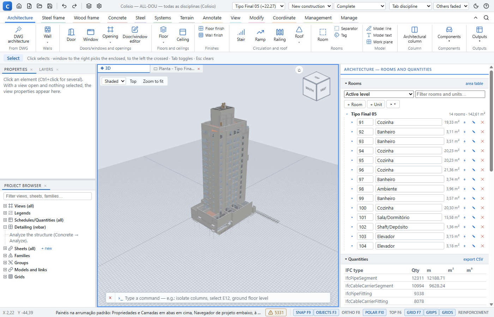

> **Language and codes.** The interface is available in **English** and **Brazilian Portuguese** — chosen in the
> installer and changeable in **Manage → Settings → Interface language**. Calculations follow the Brazilian **ABNT NBR**
> standards, so drawings, sheets and calculation reports are produced in Portuguese. Button names in this page are the
> English ones; the Portuguese name is in parentheses where it helps.

## Watch: a house rebuilt discipline by discipline

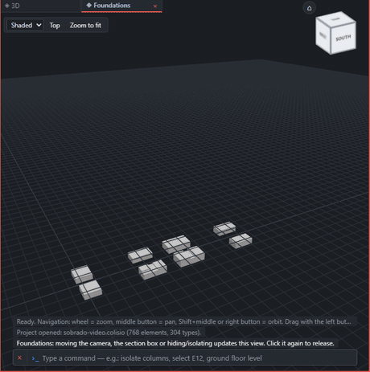

A real 145 m² three-storey row house, modelled entirely in Colisio, rebuilt step by step: foundations, columns, beams
and slabs of each level, walls, doors and stairs, roof, cold and hot water, sewer, storm water, electrical and data,
gas and the fixtures — all in the same model. **[Full video (MP4, 30 s)](media/colisio-rebuilding-the-house.mp4)**.

---

## Contents

- [Highlights](#highlights)
- [Download and install](#download-and-install)
- [Automatic updates](#automatic-updates)
- [Screenshots](#screenshots)
- [The interface](#the-interface)
- [Ribbon tabs, one by one](#ribbon-tabs-one-by-one)
- [File formats](#file-formats)
- [Standards](#standards)
- [MCP server for AI assistants](#mcp-server-for-ai-assistants)
- [Teamwork and Google Drive](#teamwork-and-google-drive)
- [Try it with the example tower](#try-it-with-the-example-tower)
- [License, third-party software and trademarks](#license-third-party-software-and-trademarks)

---

## Highlights

- **One model, every discipline.** Architecture, light steel and wood framing, reinforced concrete, structural steel,
  plumbing, drainage, electrical, HVAC, gas, fire protection, lightning protection, terrain and earthwork live in the
  same model, with the same levels, grids and views.
- **Analysis and design built in.** Frame analysis of the whole building with wind loads, second-order effects and
  global stability, followed by design and detailing of columns, beams, slabs (solid, ribbed, joist), footings and
  pile caps — with rebar in 3D, formwork plans and rebar sheets ready to deliver.
- **MEP design, not just modelling.** Pipe and conduit sizing, load schedules, voltage drop, sprinklers, emergency
  lighting, rainwater, solar heating, septic tanks — each one checked against its Brazilian standard and applied
  back to the model.
- **Drawings from the model.** Plans, sections, elevations, ceiling and roof plans, schedules and sheets with title
  blocks; export to PDF, DWG, DXF and SVG; sheet sets for permits and construction.
- **Coordination.** IFC import, linking and export — one IFC per discipline, and each run keeps its system (cold water,
  sewage, storm, fire, electrical…) both ways —, a native Revit file reader, DWG/DXF/PDF underlays, point clouds, exact
  clash detection with BCF export, and automatic routing around clashes.
- **Cost and time.** Quantities taken from the model and priced by the SINAPI of the chosen state — no server to set up:
  Colisio's own price base, built from the official Caixa spreadsheet, is fetched by state —, an organized budget sheet
  with BDI and social charges exported to **XLSX** and CSV, price per built m², ABC curve, and a 4D/5D schedule with
  critical path and S-curve.
- **Familiar workflow.** A Revit-style ribbon, contextual Modify tab, two-letter shortcuts, Properties / Project
  Browser panels, temporary hide/isolate, worksets and design options.
- **Fast.** On a desktop PC, the 30-storey example tower (16,000+ elements) is analysed in about 6 seconds, its 93
  structural sheets are generated in about 13 seconds, and a clash test of the whole building runs in about 1 second.
- **Scriptable and AI-ready.** JavaScript scripts with access to the model, and an MCP server with more than 200
  tools so assistants such as Claude can read, build and check projects.

---

## Download and install

**Requirements:** Windows 10 or 11, 64-bit, with a graphics card that supports WebGL 2.

1. Open the **[latest release](https://github.com/Colisio-BIM/Colisio/releases/latest)**.
2. Download **`Colisio_<version>_x64-setup.exe`** (the full installer, about 210 MB). It includes the Microsoft
   WebView2 runtime, so it installs even without internet access.
3. Run it and choose the language (**English** or **Português**) — it is also the language of the program (change it
   later in **Manage → Settings**). Colisio installs for the current user — no administrator rights needed — and adds
   Start menu and desktop shortcuts.

The installer is not signed with a Microsoft publisher certificate yet, so the first time Windows may show
*"Windows protected your PC"*: click **More info → Run anyway**.

To connect an AI assistant, also download **`colisio.mcpb`** from the same release (see
[MCP server](#mcp-server-for-ai-assistants)).

## Automatic updates

When it opens, Colisio checks this repository for a newer version. If there is one, it shows **Update now** and
**What's new** on the start screen and in the options bar. Updating downloads only the
small update installer (about 5 MB), **verifies its digital signature** — an installer that was not signed by Colisio
is refused — closes the program, installs, and opens it again in a few seconds. Unsaved work is kept in the recovery
copy and offered back when the program reopens.

Without internet the check simply does not happen; everything else works offline. You can also check by hand in
**Manage → Help → Updates**.

---

## Screenshots

All screenshots show the English interface and a real 22-level residential building modeled with every discipline
(architecture, concrete structure, plumbing, sanitary, fire protection, electrical, telecom and lightning protection).
Drawings and sheets stay in Portuguese, as they are delivered in Brazil.

| | |
|---|---|
| 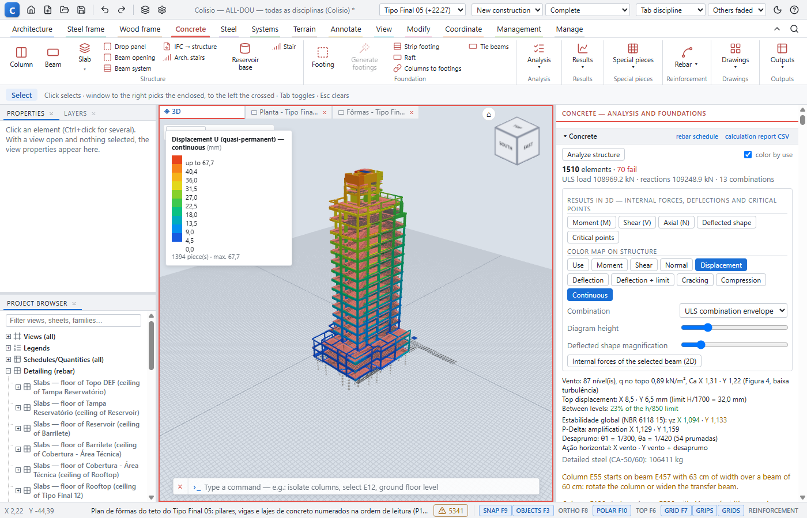 | 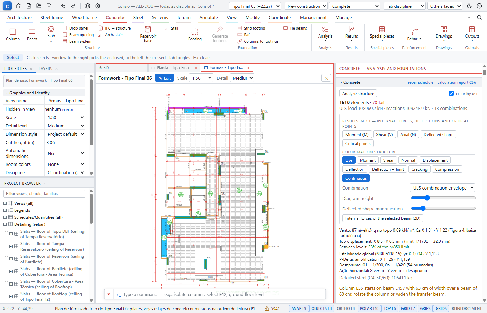 |
| **Concrete analysis** — the whole frame analysed with wind and second-order effects, colored by displacement; results panel with γz, drifts and P-Delta. | **Formwork plan** — columns colored by situation (starts, ends, continues), numbered beams and slabs, dimensions in cm. |
| 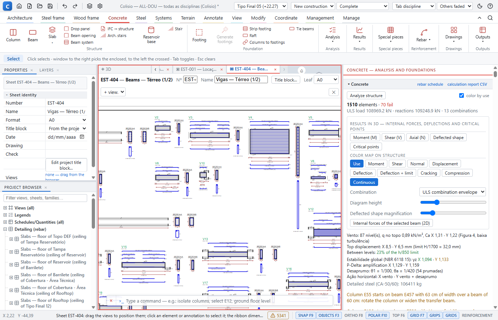 | 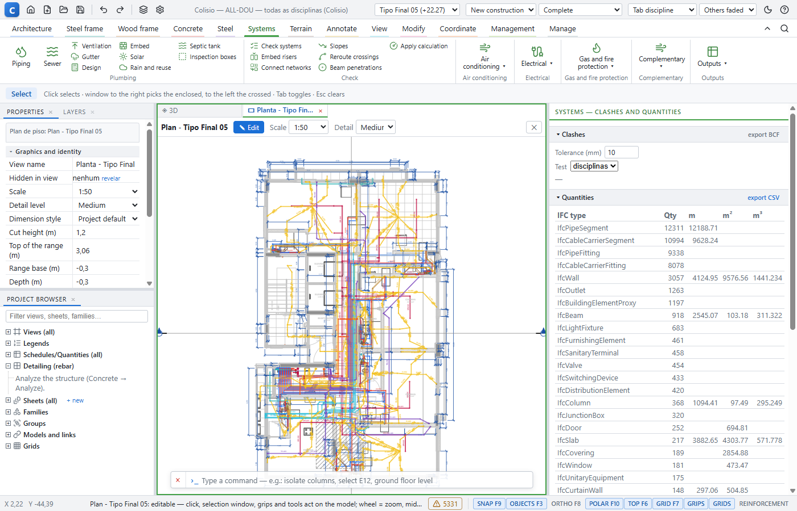 |
| **Rebar sheets** — beam elevations with stirrup zones, sections, bar marks, steel schedule and title block on A0. | **MEP plan** — water, hot water, sewer, electrical and telecom on the typical floor, by system color. |
| 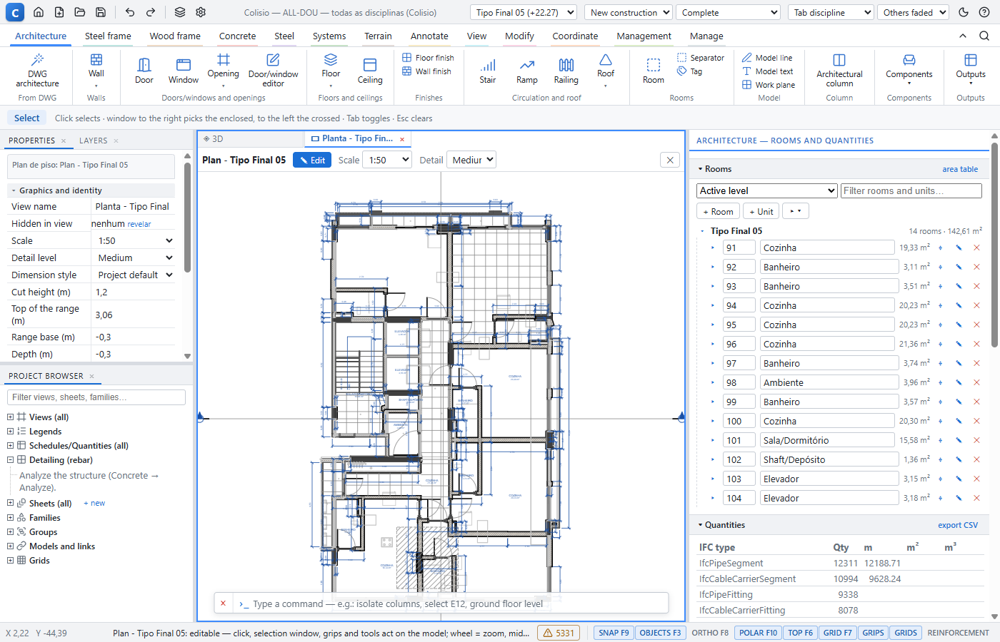 | 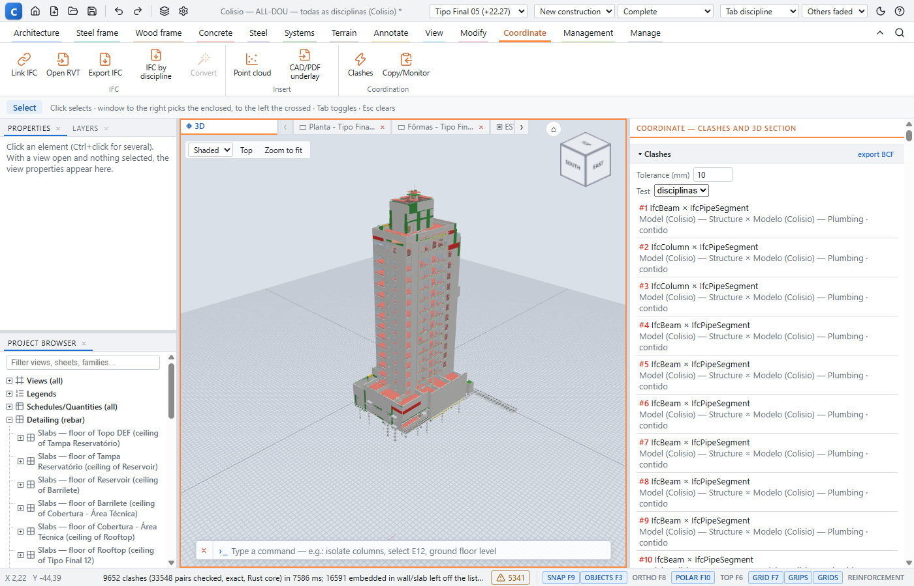 |
| **Floor plan** — editable plan with rooms, doors, windows, furniture and fixtures. | **Clash detection** — every discipline against every other, exact and fast, with BCF export. |
| 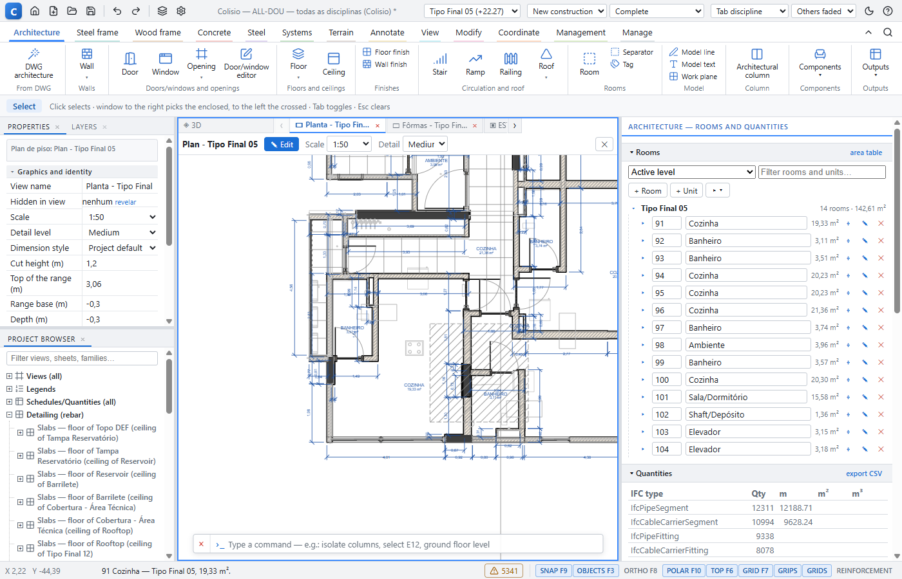 | |
| **Rooms by level and unit** — rooms listed by level (and nested in the apartments that contain them); Locate opens the plan and highlights the room. | |

The house of the video, with the drawings Colisio produced for it:

| | |
|---|---|
| 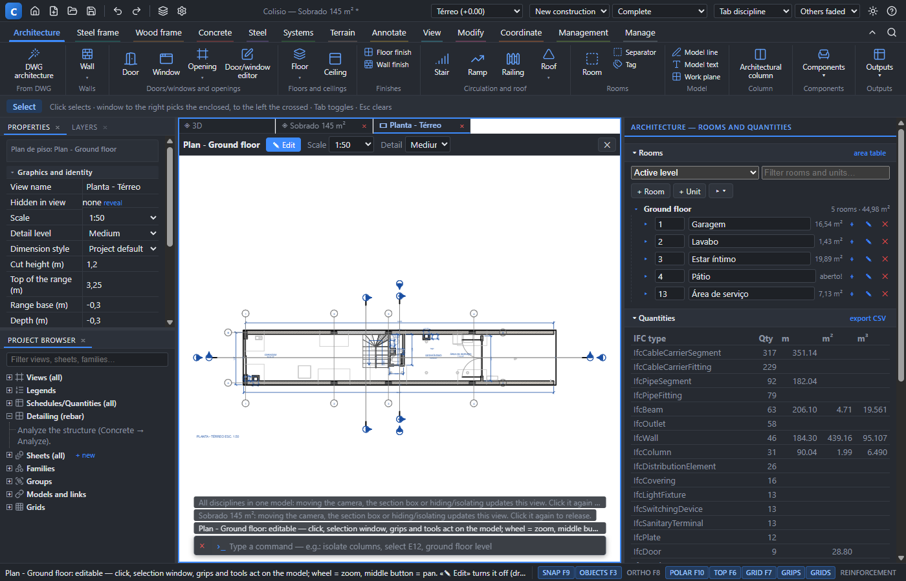 | 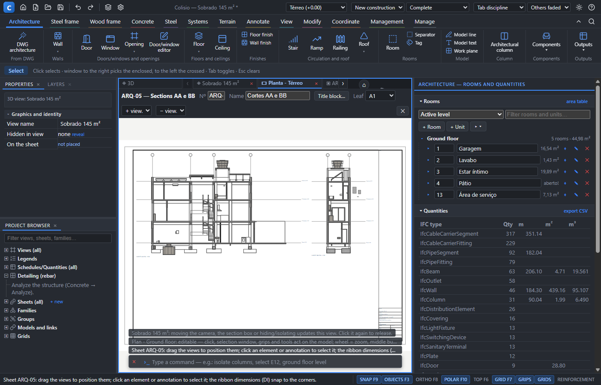 |
| **Editable floor plan** of the ground floor. | **Sections sheet** — sections AA and BB placed on a sheet. |
| 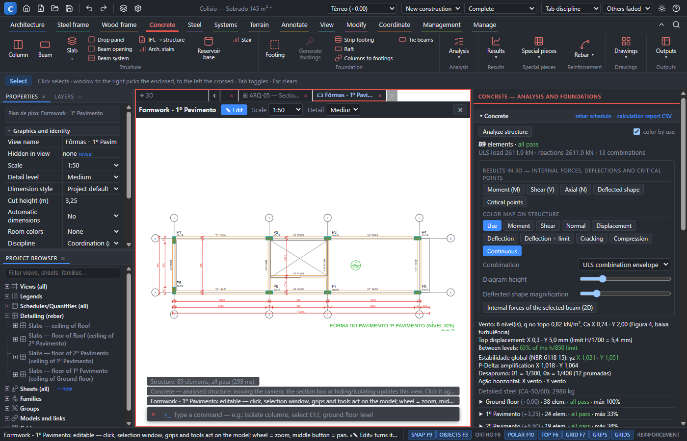 | 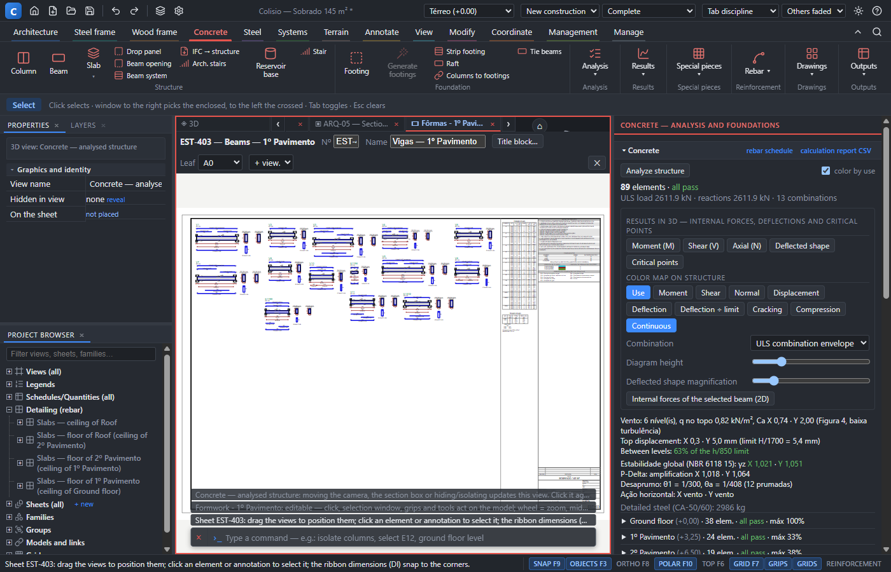 |
| **Formwork plan** of the first floor. | **Beam reinforcement sheet** generated from the analysis. |
| 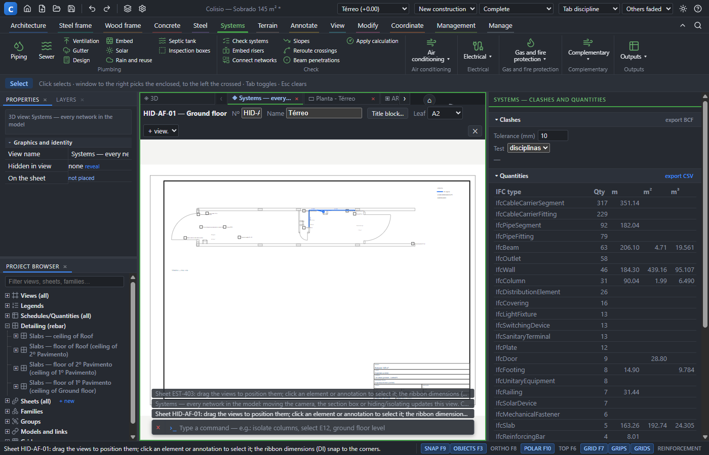 | 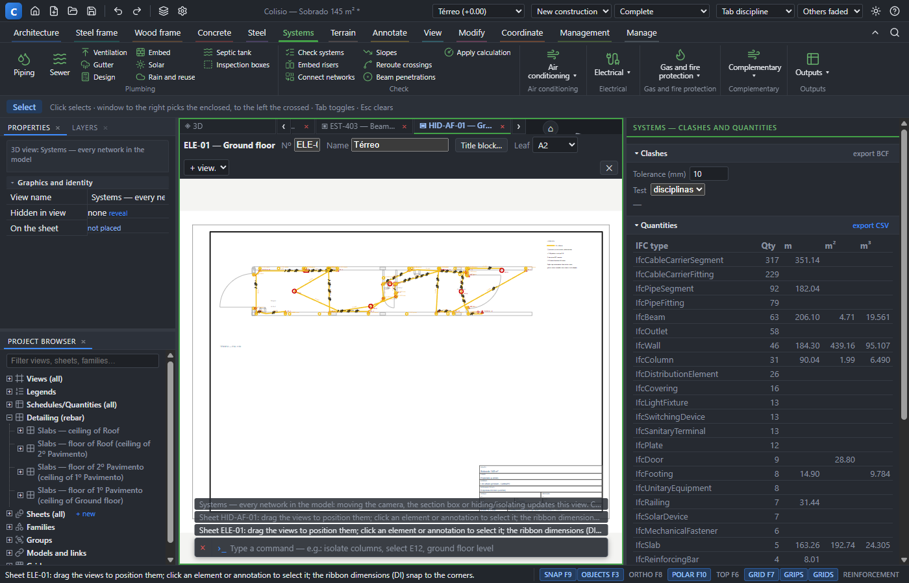 |
| **Cold water** — ground floor sheet. | **Electrical** — ground floor sheet. |
| 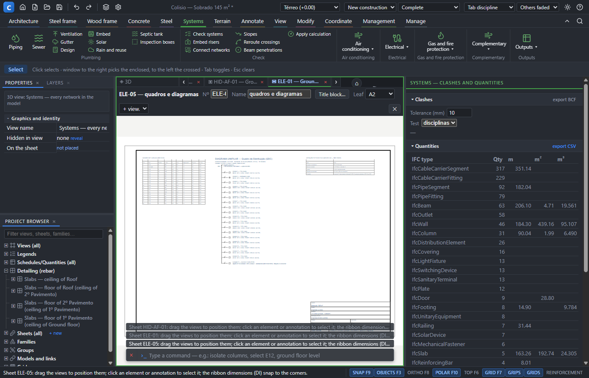 | |
| **Electrical schedules and diagrams** — load schedule and single-line diagram. | |

---

## The interface

- **Ribbon** with 13 tabs (described below) and a contextual **Modify | …** tab that appears with the selection
  (select similar, select all instances, edit type, reinforcement, zoom). Each tab has its own color, and the 3D view
  frame takes the color of the active tab.
- **Discipline by tab.** On the Concrete or Systems tabs, the other disciplines are faded so you see what you are
  working on; the **Tab discipline / Others faded** controls on the top bar change this.
- **Dockable panels**, like Revit's palettes: **Properties**, **Project Browser** and **Layers**. Drag a tab onto
  another panel to group them as tabs, or to the top or bottom of either side to keep it separate there.
  **View → Windows** opens, closes and resets them.
- **Context panel** on the right, which changes with the tab: rooms and areas, structural results, clashes, quantities.
  The **Rooms** panel is a tree — level → unit (apartment, office, shop) → rooms — built from position: a unit drawn
  inside another nests in it, and so do its rooms. **+ Unit** draws a unit, **Locate** opens the plan, frames and
  highlights a room or unit, and filters narrow it by text and level.
- **Options bar** under the ribbon with the settings of the current tool, a **command line** in the 3D view that
  understands English and Portuguese (*"isolate columns"*, *"select E12"*, *"ground floor level"*…), and a **status
  bar** with snaps and toggles: SNAP (F9), OBJECTS (F3), ORTHO (F8), POLAR (F10), TOP (F6, orthographic top view),
  GRID (F7), GRIPS, GRIDS.
- **Views in tabs**: 3D, plans, sections, elevations, schedules and sheets, plus a **split screen** with the editable
  plan next to the live 3D. A ViewCube, orbit around the selection, walk mode and section box.
- **Keyboard shortcuts** in the Revit style (two letters: WA wall, DR door, CL column…) or a simple one-key profile;
  every ribbon command can get its own shortcut (**Manage → Help → Shortcuts**).
- **Start screen** with recent projects as cards with a 3D thumbnail, and the projects in Google Drive.
- **Warnings** like Revit's: duplicate elements, overlapping walls, beams inside beams, fixtures
  entering walls — click one to go to the element.
- Light and dark themes for the program and for the 2D views; interface in English or Brazilian Portuguese.

---

## Ribbon tabs, one by one

### Architecture (Arquitetura)

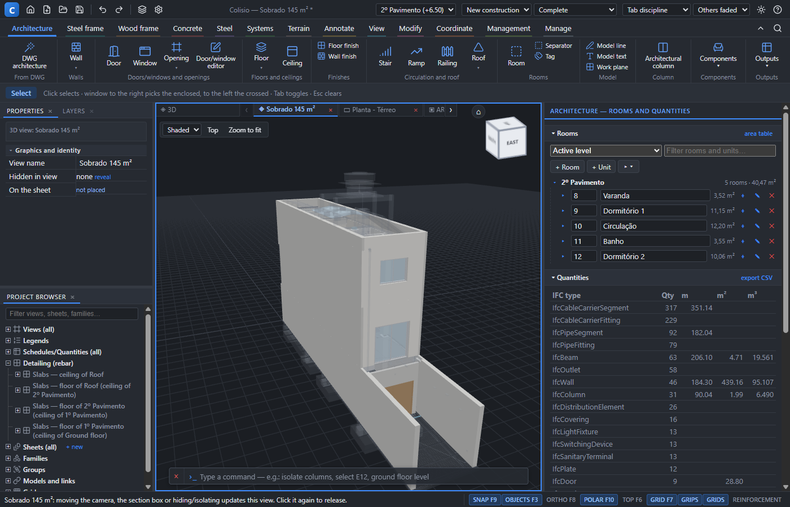

*Architecture tab: the model in 3D, rooms by level on the right.*

- **From DWG**: **DWG architecture** turns a DWG/DXF underlay into a model — walls from pairs of parallel lines, doors
  from the leaf, windows from their blocks, openings, columns, floor slab and rooms from texts. Each plan of the
  drawing goes to its level (basements below the ground floor) and the plans are stacked by the walls and stairs they
  share — or by a common point you pick on two plans —, with preview, layer choice and a list of warnings of what to
  check. On houses built on the lot line, the lot outline becomes a boundary wall where only the yard touches it. The
  drawing's dimensions are read and checked against the recognized walls; written levels ("+3.06") and the door and
  window schedule (code, height, sill) are used when the drawing has them.
- **Walls**: straight, curved and curtain walls (mullion grid and glass panels).
- **Doors/windows and openings**: doors, windows, wall openings, sunshades, and the **Door/window editor** to draw new
  types (leaves, sliding/swing/awning/pivot/folding, transoms, fire doors).
- **Floors and ceilings**: floors/slabs with slope, ceilings, slab openings and shafts through several floors.
- **Finishes**: floor tiling with layout and tile count, and wall tiling on wall faces.
- **Circulation and roof**: stairs (NBR 9050 / Blondel), ramps (up to 8.33 %), railings, roofs by footprint or by
  extrusion (vault, gable, shed, sawtooth), roof openings, dormers, and walls attached to the roof.
- **Rooms**: rooms, room separators and room tags (name, number, area, perimeter, height, finish, live load). Units
  (apartments, offices) are areas of the **Units** scheme; the Rooms panel groups and nests rooms inside them.
- **Model**: 3D model lines, 3D model text and the work plane.
- **Column** / **Components**: architectural (non-structural) columns, furniture, fixtures and equipment from the
  family library — doors with frame, hinges and handle, windows with sashes and latches, detailed furniture and
  fixtures —, with a thumbnail of the selected element in Properties.
- **Outputs**: architectural bill of materials (blocks, mortar, tiles, paint, ceilings, doors and windows, roof) and a
  drawn door and window schedule with marks and quantities.

### Steel frame — light steel framing (NBR 16970)

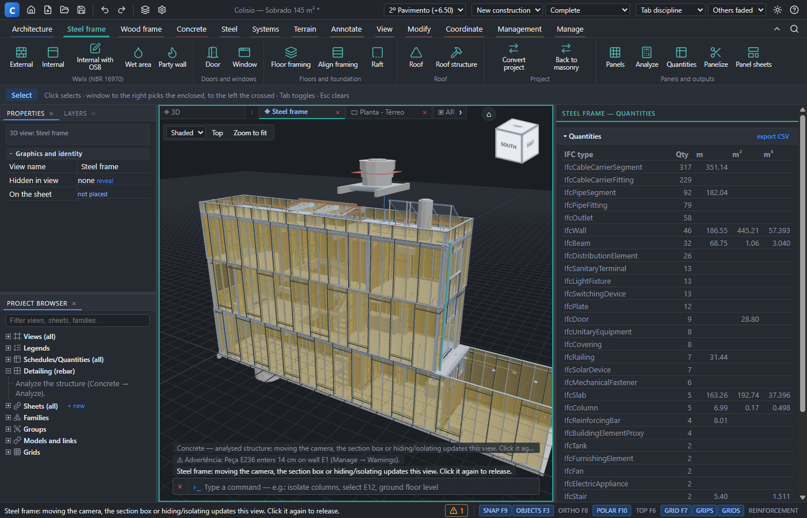

*Steel frame tab: the same house after **Convert project** — studs, tracks and OSB panels of every wall and floor.*

External, internal, OSB-lined, wet-area and party walls; doors and windows that create their own jambs, headers, sills
and cripples; floors framed as real members — joists at the stud module in line with the studs, rim track, web
stiffeners, bridging and built-up beams around openings, with **Align framing** to put studs under the joists — and
concrete rafts; a light roof with one truss over each stud on gable roofs; **Convert project** turns a
masonry + concrete project into steel frame in one step, and **Back to masonry** does the reverse with a pre-placement
of concrete columns and beams. Corners and T junctions are framed without overlapping members, with an **anchor plan**
in the ground-floor plan. **Analyze** designs the studs, headers, floor joists, bracing and anchorage (NBR 14762, loads
by NBR 6120, wind by NBR 6123) with colors in 3D and a calculation report, and **Quantities** lists profiles, boards,
screws and anchors, with a **cut list** by mark, wall and stock bar. **Panelize** splits long walls into
panels of up to 6 m outside openings and junctions, and **Panel sheets** generate the fabrication drawings: panel key
plan, the dimensioned elevation of each panel with piece marks and its piece table, the floor framing plan of each
storey and the overall cut list.

### Wood frame — light wood framing (NBR 16936)

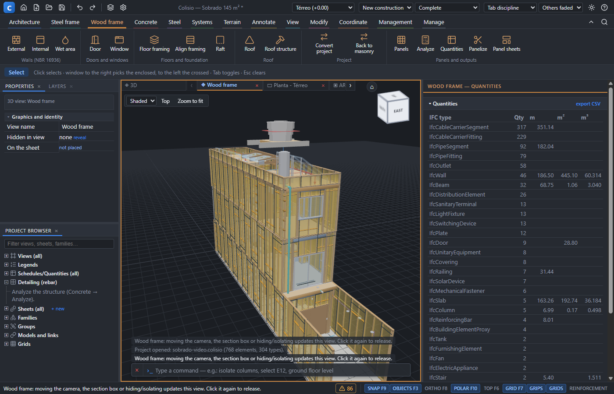

*Wood frame tab: the house converted to timber framing.*

The same workflow for timber frame: wall types, framed openings with double top plates, floors with 45×190 joists
at the stud module, rim boards and blocking, light roof trusses over the studs, project conversion both ways, design by
NBR 7190 and a takeoff of timber (m³), boards and fasteners.

### Concrete (Concreto)

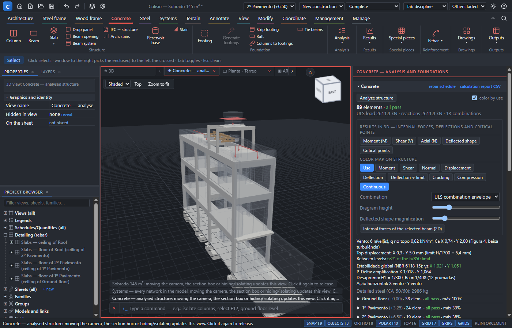

*Concrete tab: the structure analysed (NBR 6118, wind by NBR 6123) with the results panel.*

- **Structure**: columns, beams, slabs, slab and beam openings (checked by NBR 6118 13.2.5.1), drop panels and solid
  zones of ribbed slabs, beam systems, concrete stairs (straight, L, U), reservoir bases, and **IFC → structure** —
  opens a structural IFC exported by the structural design program and rebuilds the structure with sections, concrete
  class, cover and loads.
- **Foundation**: isolated footings (also generated from the analysis), strip footings, rafts, columns to footings
  and tie beams; pile caps and piles from a structural IFC are designed and detailed too.
- **Analysis**: design **Criteria** (allowed bar sizes, spacing, minimum and maximum dimensions), **Analyze**
  (NBR 6118 with wind by NBR 6123 and global stability), **Design** (sizes until everything passes: enlarges what
  fails, adds missing foundations and recalculates), manual loads and suggested sections.
- **Results**: moment, shear and axial diagrams in 3D, deflections of each beam, critical points, and the 2D diagrams
  of a beam (PDF/DXF). Color maps by utilization, moment, shear, axial force, displacement, deflection, cracking and
  compression.
- **Special pieces**: ribbed slabs (NBR 6118 13.2.4.2), joist-and-block slabs, cantilever retaining walls, concrete
  water tanks, timber members (NBR 7190) and structural masonry (NBR 16868-1).
- **Reinforcement**: reinforcement of every member as 3D objects you can edit, plus loose rebar and welded wire mesh
  (NBR 7481).
- **Drawings**: **Formwork** plans; **Rebar detailing** — the full structural sheet set (column layout, formwork,
  foundations, columns, beams, slabs per direction, punching, stairs, tanks) on A0 with the structural title block and
  steel schedules; and **Delivery** — one folder per series, each sheet in DWG (AutoCAD 2000, with layers, colors and
  pens) and PDF with standard file names.
- **Outputs**: concrete and steel quantities, calculation report and a summary for the engineer (stability, transfer
  beams, cantilevers, failing members, most loaded columns, foundations).

### Steel (Metálica)

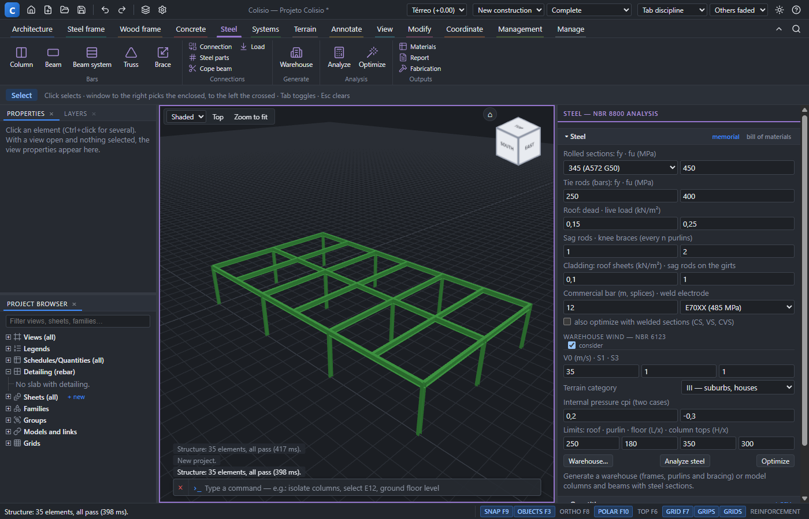

*Steel tab: a steel frame checked by NBR 8800, colored by utilisation.*

W/HP columns and beams from the Gerdau catalogue, beam systems, trusses (Pratt, Howe, Warren, cold-formed), X bracing;
**Connection** (base plates, shear tabs, bolts, welds) designed by NBR 8800, **Steel parts** and **Cope beam**; a
**Warehouse** (portal frame) generator; **Analyze** by NBR 8800 (local buckling, lateral-torsional buckling,
interaction, B1/B2 second order) with wind by NBR 6123; **Optimize** (lightest passing section); bill of materials,
calculation report, and **Fabrication** marks, cut lists and assembly drawings.

### Systems (Sistemas)

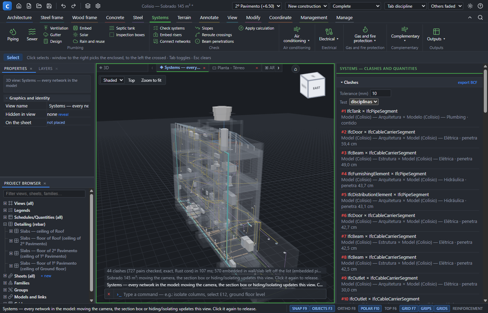

*Systems tab: water, sewer, storm water, gas, electrical and data in the same model, with the architecture faded.*

- **Plumbing**: piping for cold and hot water, recirculation, sewer, grease, vent, storm water, reuse water and fire;
  gutters; **Design** of cold water (NBR 5626) and sewer (NBR 8160); **pipe lines** for water — solvent-weld PVC, CPVC,
  PPR PN 20/25, PEX and HDPE —, each with its own diameter table: sizing picks the diameter the line makes and uses its
  inner diameter, a hot-water run in a cold-only line is flagged, and the bill of materials comes in bars or coils;
  fittings are generated where runs meet, plus a coupling per pipe bar, caps on capped ends and an inspection tee at the
  foot of every stack; **Embed** exposed pipes into walls; solar water
  heating (NBR 15569); rainwater harvesting (NBR 15527) and greywater reuse (NBR 16783); septic tank and disposal
  (NBR 7229 / 13969); inspection boxes.
- **Check**: system check (open ends, unconnected fixtures, separated networks), **Embed risers** in walls (shafts
  only where allowed), **Connect networks**, **Slopes** without counter-falls, **Reroute crossings** in the ceiling,
  **Beam penetrations** checked by NBR 6118, and **Apply calculation** to set all calculated diameters at once.
- **Air conditioning**: rectangular, round and flexible ducts, air terminals, condensate drains, refrigerant lines,
  placeholders that convert to real runs.
- **Electrical**: conduits (normal and life-safety), busways, cable trays, wiring by circuit with conduit fill
  (NBR 5410), automatic conduit routing from the points, receptacles, lights, switches and panels, load forecast
  (NBR 5410), communications (NBR 14565), photovoltaics (NBR 16690), riser diagram and **Panel schedule** (cable sizes
  with grouping and temperature factors, breakers, voltage drop, phase balance, short circuit, selectivity).
- **Gas and fire protection**: gas piping (NBR 15526), sprinklers (NBR 10897), **Egress** (NBR 9077), emergency
  lighting (NBR 10898) and **emergency signage by rule** (NBR 13434): a sign above each extinguisher, hydrant and
  alarm call point, "Exit" over exit doors and route signs every 15 m, each sized by its viewing distance — one button
  places what is missing. The fire sheet draws each item with its own symbol and a legend of what the plan has.
- **Complementary**: air conditioning and ventilation (NBR 16401), waterproofing (NBR 9575), soil and shallow
  foundations, layers, lightning protection (SPDA, NBR 5419-3, mesh method) and clash detection.
- **Outputs**: MEP bill of materials, calculation reports, and MEP sheets per discipline with legends, sizing tables,
  isometrics and single-line diagrams.

### Terrain (Terreno)

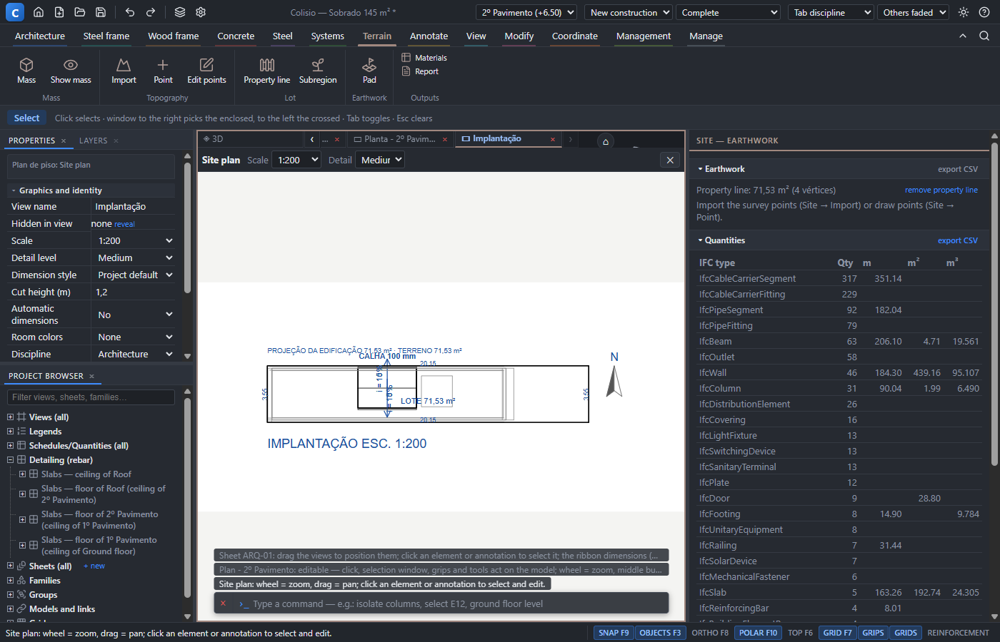

*Terrain tab with the site plan open.*

Conceptual masses (area, volume, mass floors), terrain from survey points (CSV/TXT) or DXF contour lines, property line
for the area table (site coverage and floor area ratio), subregions (paving, lawn, permeable areas), earthwork **Pads**
with cut, fill, slopes and balance level, and the earthwork bill of materials and report.

### Annotate (Anotar)

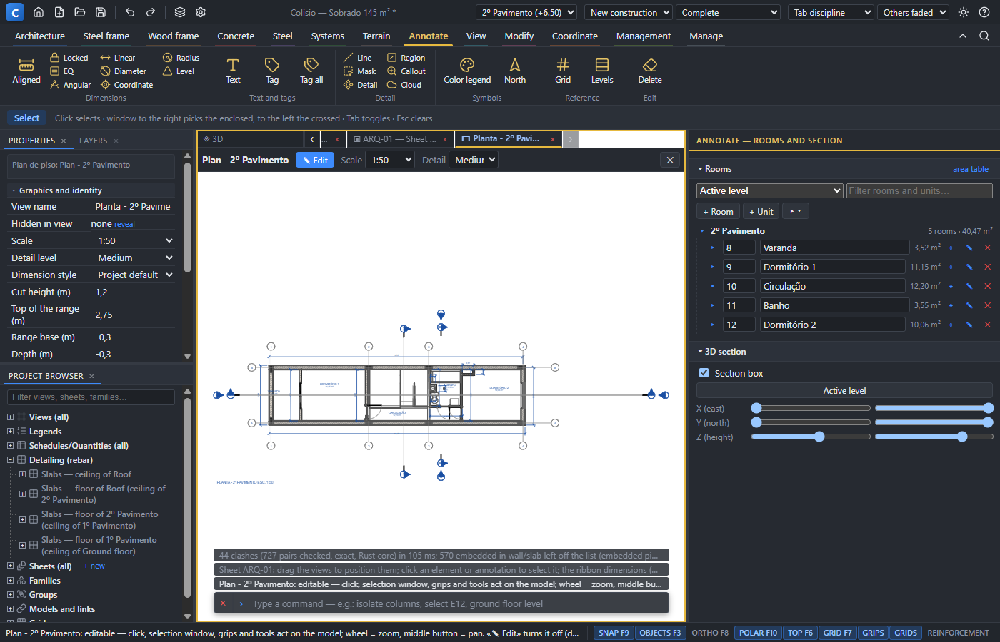

*Annotate tab on a floor plan with grids, dimensions and section marks.*

Aligned, locked, equal-spacing (EQ), angular, linear, diameter, radius, coordinate and level dimensions —
**associative**, they follow the walls, beams, columns, openings and grids they measure; whole-wall dimensioning with or
without openings and intersections. Text, tags and **Tag all** for doors and windows; detail lines, masking regions, 2D
detail components, filled regions, callouts and revision clouds; color legends and north arrow; grids and levels.

### View (Vista)

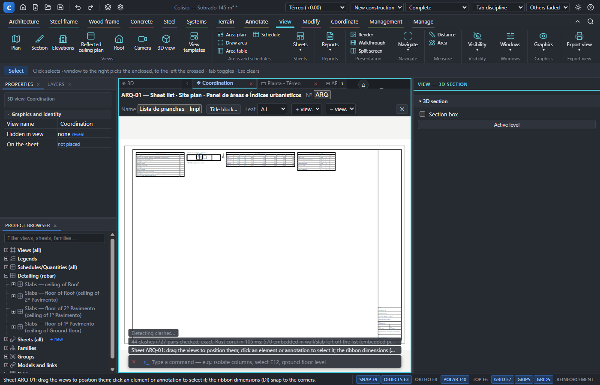

*View tab: a sheet assembled by **Sheets** with the sheet list, the site plan and the area tables.*

Floor plans, sections, elevations, reflected ceiling plans, roof plans, cameras, saved 3D views and view templates;
area plans, area tables with urban indexes and schedules; sheets, **Generate sheets** (permit set or construction set),
batch PDF/DXF, **Renumber** and **Publish** (choose sheets and order, single PDF or one file per sheet in PDF, DXF or
DWG). Reports: project specification, calculation reports, accessibility (NBR 9050), minimum room areas, energy model
(gbXML for EnergyPlus, OpenStudio and IES), performance (NBR 15575 / 15220), the technical-responsibility
form (ART/RRT) and a bill of materials of every discipline. Presentation: **Render** up to 4K with the real sun,
**Walkthrough** video (WebM) and **Split screen**. Navigation, measuring, temporary hide/isolate, hide in view, reveal
hidden, layers, Visibility/Graphics (VV), thin lines, and export of the open view.

### Modify (Modificar)

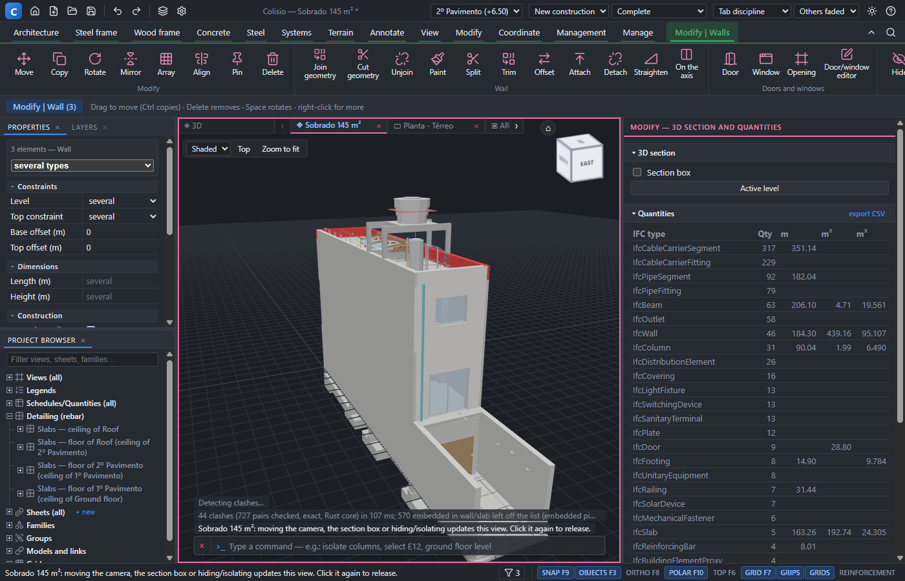

*Modify tab with a selection: the contextual tools appear on the ribbon.*

Move, copy, rotate, mirror, array (linear and radial) and scale; join, cut and unjoin geometry; paint faces with
materials; clipboard with paste aligned and paste to levels; groups and linked copies across levels (typical floors);
split with gap, trim/extend, align, offset, match type; walls onto the structural axis; **Seat fixtures** on walls,
ceilings and floors; **Straighten** what came almost square from IFC/DWG; pin, demolish, edit outline, attach/detach to
roofs and slabs, delete.

### Coordinate (Coordenar)

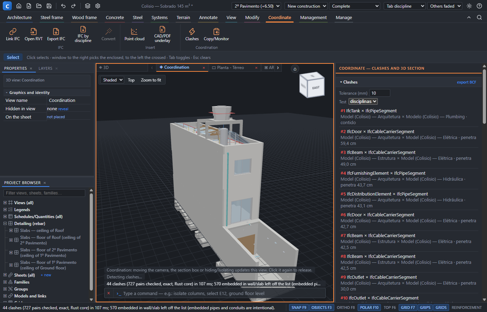

*Coordinate tab: clash detection across the disciplines of the model.*

Link IFC models of other disciplines, open Revit files (`.rvt` and `.rte` templates, 2017 to 2027 formats, read by
Colisio's own reader — no Autodesk software involved — including the pipes, ducts, conduits and cable trays, each on
its system and joined into a closed network, the electrical circuits and panels with their feeder tree, phases,
design options — the primary option shown and the alternatives kept aside as Colisio design options —, isolated
foundations as footings and pile caps, and steel members with the profile given by the dimensions stored in each
type), export IFC4 — the whole model or **IFC by discipline** (one file
each for architecture, structure, plumbing, sanitary and storm, fire protection, gas, electrical, telecom, lightning
protection and air conditioning) —, convert linked IFC elements into editable ones, insert point clouds (LAS, PLY, XYZ,
PTS, TXT — up to 2 million points) and DWG/DXF/PDF/image underlays, detect **Clashes**, and **Copy/Monitor** levels and
grids from linked models.

Converting a linked IFC gives each pipe, duct, conduit and lightning-protection conductor the system the file states:
its system group (IfcDistributionSystem / IfcSystem — Colisio and Revit names, IFC4 type), a network property written
by the MEP program ("Cold water (Reuse)", "Sewage (Grease)", "Storm (A/C drain)", "Electrical (Fire)"…) or its name. Fittings
are left to Colisio, which generates its own where runs meet. **Manage → Links** lists each linked IFC with the systems of
its runs and whether the file is up to date, changed or missing; Reload, Replace file (another revision), Hide/Show (saved
in the project) and Remove — and elements already converted stay hidden in the link after reloading or reopening.

### Management (Gestão)

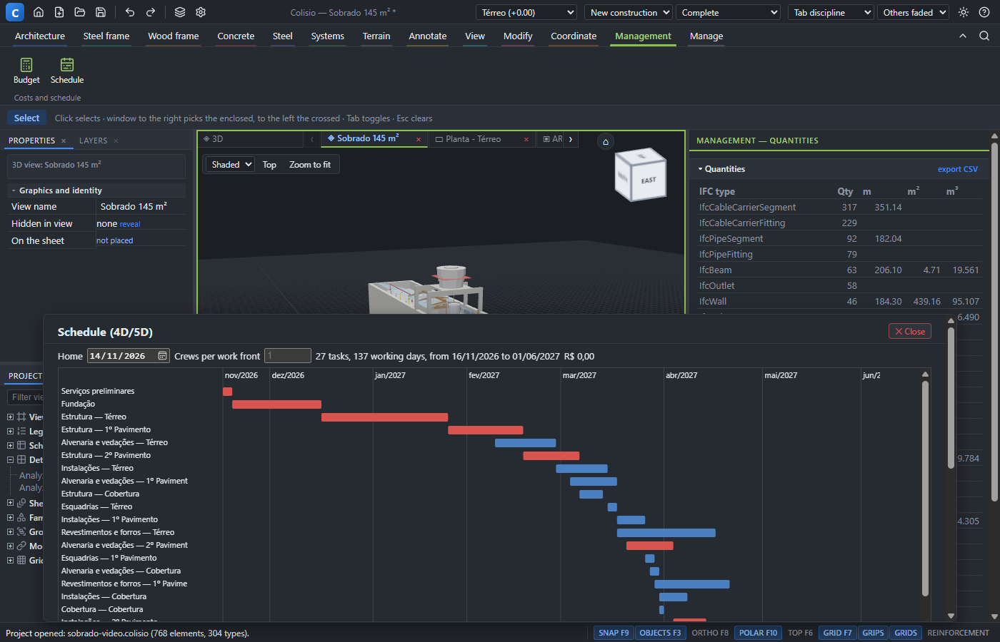

*Management tab: the schedule (4D/5D) generated from the model.*

**Budget**: services measured in the model; choose the state and regime and **Calculate prices (SINAPI)** — each
service gets the cost of its SINAPI composition for the latest published month. Nothing to configure: the prices come
from Colisio's price base (SINAPI — Caixa Econômica Federal / IBGE, one file per state, built from the official monthly
spreadsheet) and the compositions are matched to the services on your computer; a small ⚙ lets you point to your own
[autoSINAPI](https://github.com/LAMP-LUCAS/autoSINAPI_API) server instead. Services without a composition get the
closest one in the same unit, marked for review, and the **price per built m²** at the top warns when the total is
outside the usual range for buildings. When a month is not in the published base yet, **⚙ → Caixa workbook** opens the
official monthly file in your browser, picks it up from the Downloads folder and stores the prices of all 27 states on
your computer (an already downloaded file works too); costs can also be typed by hand. The budget sheet has
tabs for the summary sheet by stage (material, labor, unit cost, price with BDI, stage totals), cost by stage with % of
the total, a summary, project data with BDI by the TCU formula and social charges, and the ABC curve — exported to
**XLSX** (four sheets) and CSV. **Schedule**: tasks by stage and level, critical path (CPM), 4D simulation in 3D and a 5D cost
schedule with S-curve.

### Manage (Gerenciar)

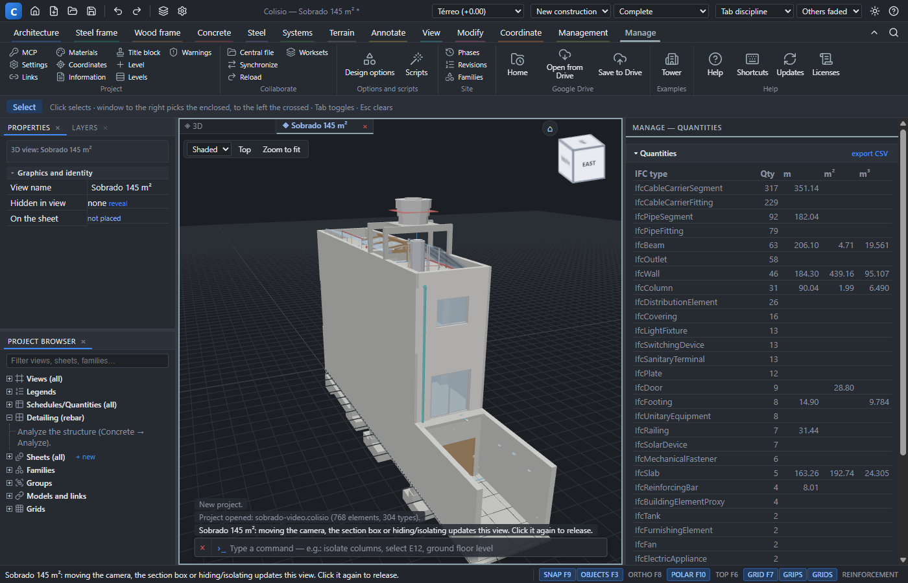

*Manage tab: project, collaboration, design options, scripts, Google Drive and help.*

MCP access (tokens and permissions per client), **Settings** (interface language, units, dimensions, snaps, themes),
links, materials, coordinates and true north, project information, title blocks, levels, warnings; central file,
synchronize, reload and worksets; design options and **Scripts** (JavaScript with access to the model, like Dynamo
Player); phases, revisions and parametric families; Google Drive; the example **Tower**; help, keyboard shortcuts,
updates and third-party licenses.

---

## File formats

| | Open / import | Save / export |
|---|---|---|
| Project | `.colisio` | `.colisio` (with automatic recovery copy) |
| BIM | IFC (open, link, convert with systems, structural IFC), Revit `.rvt` / `.rte`, 2017–2027 formats (native reader) | IFC4 (whole model or one per discipline) |
| CAD | DWG, DXF (underlay or model generation) | DWG (AutoCAD 2000, with layers, colors and pens), DXF |
| Documents | PDF and images (PNG/JPG) as underlays | PDF (vector), SVG, PNG render, WebM video |
| Survey | Point clouds LAS, PLY, XYZ, PTS, TXT; terrain points CSV/TXT; contour lines DXF | — |
| Data | SINAPI price base (automatic), official SINAPI workbook (XLSX/CSV), autoSINAPI API, groups (`.colisio-grupo`) | Budget sheet (XLSX, CSV), CSV quantities, BCF clashes, gbXML energy model |

## Standards

Colisio checks and designs by the Brazilian ABNT standards, among them: **structures** NBR 6118, 6120, 6123, 8800,
14762, 7190, 16868-1, 16970, 16936, 7481; **building systems** NBR 5626, 8160, 10844, 15526, 5410, 14565, 16690,
5419-3, 10897, 9077, 10898, 16401, 15569, 15527, 16783, 7229, 13969, 9575; **architecture and performance**
NBR 9050, 15575, 15220.

All results are design aids and **must be checked by a licensed professional**.

---

## MCP server for AI assistants

Colisio includes a [Model Context Protocol](https://modelcontextprotocol.io) server with more than 200 tools to read
the model, create and edit elements, run calculations, generate drawings and check clashes.

1. Download **`colisio.mcpb`** from the [latest release](https://github.com/Colisio-BIM/Colisio/releases/latest) and
   open it with your MCP client (Claude Desktop, Cursor, VS Code and similar).
2. With Colisio open, the assistant works on the project on screen. Without the program, it can read a `.colisio`
   file directly.
3. Access is controlled per client in **Manage → MCP**: tokens and permissions to read, edit, drive the interface,
   handle files and run scripts.

The MCP tools come from the program, so they update together with it.

## Teamwork and Google Drive

- **Central file** in a shared folder, like Revit's central model: synchronise merges changes element by element;
  worksets control who edits what.
- **Google Drive**: open and save projects in Drive (through Google Drive for desktop); the start screen lists them,
  and the program warns when the open file was saved from another computer.

## Try it with the example tower

**Manage → Examples → Tower** builds a 30-storey residential tower — ground floor, two parking levels, amenities and
26 typical floors with four apartments each — with concrete structure and building systems. Then try
**Concrete → Analyze**, **Concrete → Rebar detailing**, **Coordinate → Clashes** and **Management → Budget**.

---

## License, third-party software and trademarks

Colisio is proprietary software: you may download, install and use it, including professionally — see the
[license](LICENSE). This repository contains only the installers; the source code is not public.

The program includes open-source components under their own licenses (MIT, Apache-2.0, BSD, ISC, Zlib, MPL-2.0 and
others). The full list and the license texts are in **Manage → Help → Licenses** inside the program.

Revit and AutoCAD are trademarks of Autodesk, Inc.; SINAPI is maintained by Caixa Econômica Federal and IBGE. Colisio is not affiliated with these companies;
their names are used only to describe compatibility.
