# Colisio

**Desktop BIM for building design in Brazil: architecture, reinforced-concrete analysis and detailing, building systems,
quantities and budget, drawings and coordination, in one model.**

-0078d4)

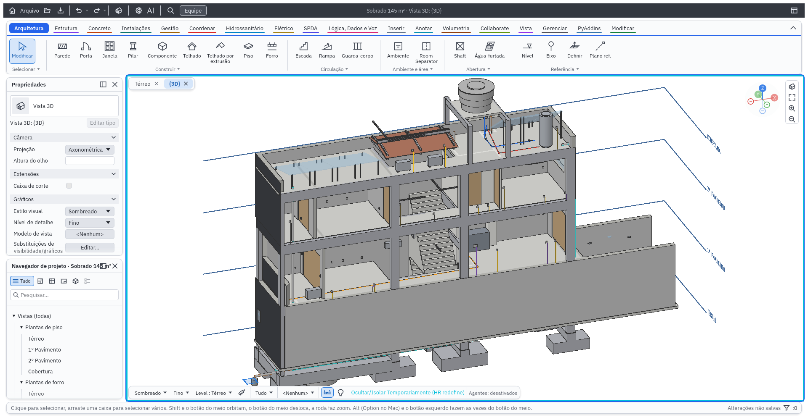

> **Language and codes.** The interface is in **Brazilian Portuguese** or **English** (File → Settings → Interface). The
> calculations follow the Brazilian **ABNT NBR** standards, so drawings, sheets and calculation reports come out in
> Portuguese. Button names on this page are the Portuguese ones, as the screenshots show them.

## Watch: a house built and calculated

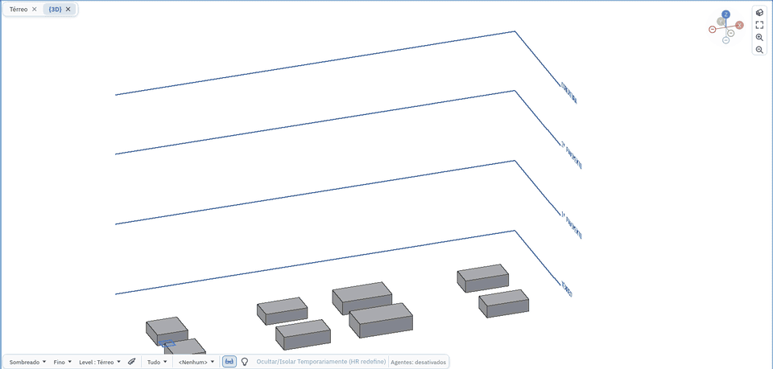

A real 145 m² three-storey row house (*sobrado*), designed in Colisio, put together the way it is built — footings,
columns, beams, slabs, stairs, walls, doors and windows, water, sewer, storm water, gas, electrical and data, the
fittings and the roof, each level from the bottom up —, then calculated: every piece of the structure passes, and the
bending moments of the beams and columns are drawn over the 3D view, turning round. The view is a cutaway: the party wall
on the camera's side is hidden (Hide Element), so the inside shows. **[Full video (MP4, 17 s)](media/colisio-sobrado.mp4)**.

---

## Contents

- [Colisio 1.0](#colisio-10)
- [Highlights](#highlights)
- [Download and install](#download-and-install)
- [Updates](#updates)
- [Screenshots](#screenshots)
- [The interface](#the-interface)
- [Ribbon tabs, one by one](#ribbon-tabs-one-by-one)
- [File formats](#file-formats)
- [Standards](#standards)
- [Projects of Colisio 1.9](#projects-of-colisio-19)
- [AI assistants and scripts](#ai-assistants-and-scripts)
- [Teamwork](#teamwork)
- [Try it with the teaching house](#try-it-with-the-teaching-house)
- [License, third-party software and trademarks](#license-third-party-software-and-trademarks)

---

## Colisio 1.0

Colisio 1.0 is a new program: a full BIM modeller with a Revit-style workflow, and inside it everything Colisio
calculates and draws — the concrete structure, the building systems, the budget and the sheets. Its projects are
`.colisio` files of a new kind. The earlier program, Colisio 1.9, is still available (see
[Projects of Colisio 1.9](#projects-of-colisio-19)).

## Highlights

- **One model, every discipline.** Architecture, structure and building systems share the same levels, grids and views:
  plans, ceiling plans, sections, elevations, 3D views, schedules and sheets with title blocks.
- **A familiar workflow.** A ribbon with a colour for each tab, the Modify tab in context, two-letter shortcuts, the
  Properties palette and the Project Browser, alignment guides while drawing, temporary hide and isolate, phases and
  design options.
- **Concrete structure, analysed and detailed.** Criteria by NBR 6118, loads drawn on the plan or put on the pieces, the
  frame analysed and the pieces designed, and the results drawn over the 3D view: bending moments, shear, axial forces,
  deflections and critical points. Beam systems on slabs, footings generated from the analysis, columns taken down to
  them, tie beams, strip footings, rafts, retaining walls and water tanks. Reinforcement in 3D, with an editor for each
  piece, bars and welded mesh placed by hand, formwork and reinforcement sheets and the calculation report.
- **Building systems, designed.** Cold and hot water, sewer and inspection boxes, storm water, gas, fire protection and
  sprinklers, electrical (points, conduits and panels), communications, lightning protection and air conditioning, each
  sized by its Brazilian standard, with its memorial and its sheets. Runs are drawn in Colisio's systems with market pipe
  types, the system's height and slope, and tees where they join; fittings are listed and drawn as parts. Runs are routed
  around clashes, holes through beams are checked by NBR 6118, and risers are embedded in the walls.
- **Coordination.** Clash detection of the systems against the structure, the architecture and each other, with
  numbered markers in the 3D view. IFC import and export, Revit files read, DWG and DXF drawings and point clouds.
- **Quantities and budget.** Quantities taken from the model and a budget priced by the SINAPI of the project's state,
  with BDI, the budget sheet, and the descriptive and calculation memorials.
- **Learn by doing.** *Aprender a projetar* (Gestão → Ajuda): 9 tracks and 66 steps, each checked in your own project,
  with "show me where" on the ribbon and a teaching house to start from.
- **Fast and safe.** A native program: large projects open on their own thread, the window keeps drawing while the
  engine calculates, every change is a step you can undo, and autosave keeps a recovery copy.

## Download and install

**Requirements:** Windows 10 or 11, 64-bit.

1. Open the **[latest release](https://github.com/Colisio-BIM/Colisio/releases/latest)**.
2. Download **`colisio-<version>-windows-x64.msi`**, the installer, and run it. It installs Colisio in
   *Program Files\Colisio* for every user of the computer (Windows asks for an administrator's permission), adds it to
   the Start menu (a desktop shortcut is optional), opens `.colisio` projects, and keeps it up to date.
3. Or download **`colisio-<version>-windows-x64.zip`**, the portable copy: unzip it anywhere and open `colisio.exe`.
   It writes nothing to the registry.

Both carry the calculation engine and what runs it: there is nothing else to install.

The installer is not signed with a Microsoft publisher certificate yet, so the first time Windows may show
*"Windows protected your PC"*: click **More info → Run anyway**. Each release lists the SHA-256 of its files in
`SHA256SUMS`.

## Updates

When it opens, Colisio looks for a newer version in this repository. If there is one, it says so; the installed copy
downloads the new installer, checks it against the SHA-256 GitHub and the release give, closes, installs it and opens
again on the same project. The portable copy is told of the new version and downloaded by hand. Without internet the
check simply does not happen; everything else works offline. **File → Check for updates at startup** turns the check
off.

---

## Screenshots

All on the house of the video, calculated by the program.

| | |
|---|---|
| 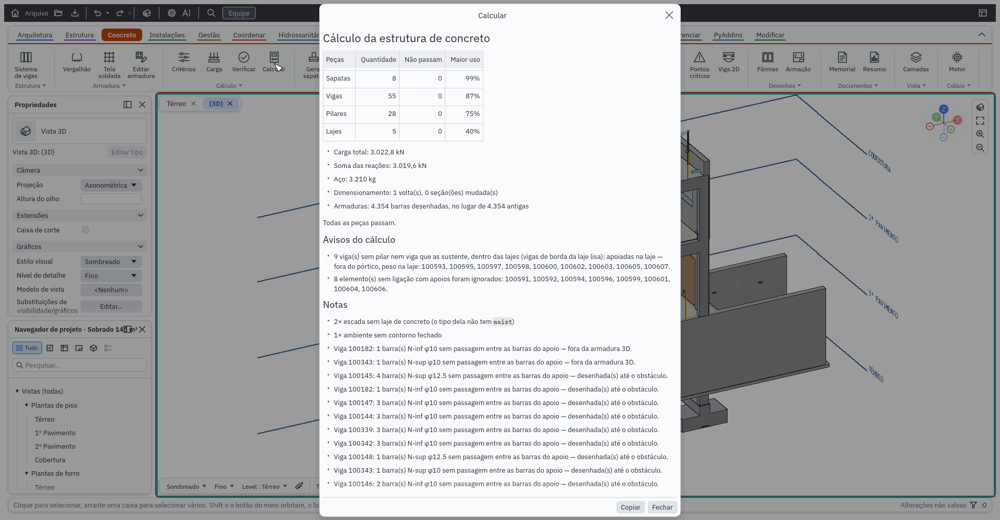 | 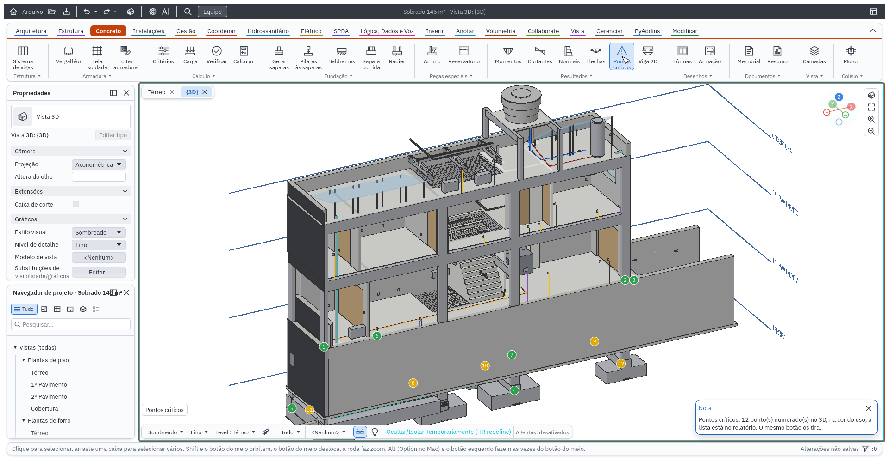 |
| **Calcular** — the structure analysed and designed: pieces that pass, loads and reactions, steel, and the criteria used. | **Pontos críticos** — the most loaded points of the structure, numbered over the 3D view, in the colour of how close they are to the limit. |
| 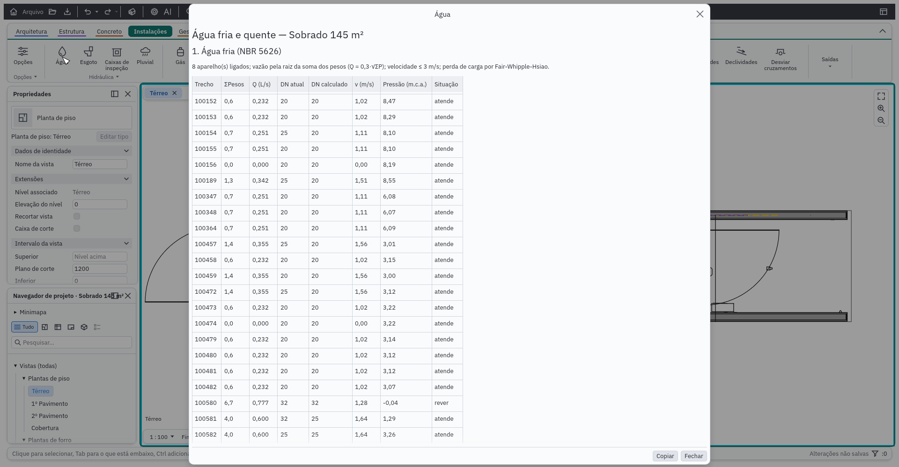 | 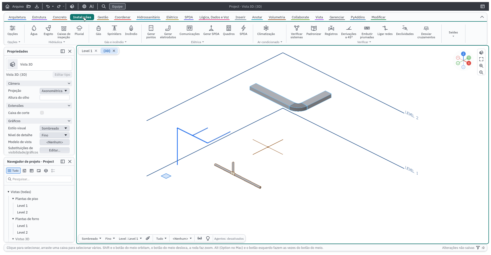 |
| **Água** — each run of cold water with its weights, flow, diameter, speed and pressure, by NBR 5626. | **Fittings** — each one a part of the model, named and sized as it is bought, in the colour of its system. |
|  | 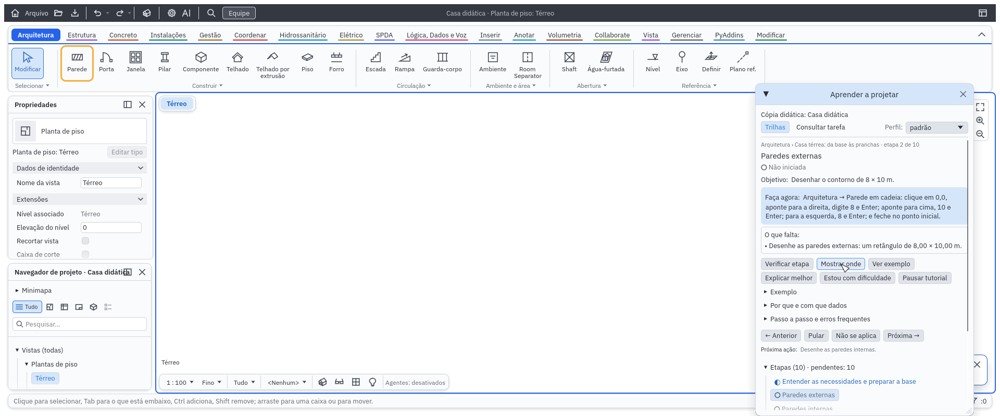 |
| **Editar armadura** — a piece's bars as calculated, edited by hand and checked again. | **Aprender a projetar** — the step in hand, what is missing, and where on the ribbon to find it. |

## The interface

- **Ribbon** with the tabs described below, each in a colour of its own, the view outlined in the colour of the tab
  open, and a contextual **Modificar | …** tab that appears with the selection. A second look puts the tools in a
  palette instead of the ribbon.
- **Palettes that dock and float**: **Properties**, **Project Browser** (with a minimap), and the Colisio's panels such
  as *Aprender a projetar*. Any view can float in a window of its own.
- **Views in tabs**: floor and ceiling plans, sections, elevations, 3D views, schedules and sheets. The 3D view has a
  navigation triad, a section box, fly mode (FY) and 3D mice.
- **Drawing like Revit**: two-letter shortcuts (WA wall, DR door, CL column…), editable in **Teclas de atalho**;
  snaps, alignment guides and the Options Bar of each tool; **Find** (Ctrl+K) finds any tool or view by name.
- **View control bar** under each view: scale, detail level, visual style, temporary hide/isolate, and reveal hidden
  elements.
- **Start page** with the recent projects, templates and the sample projects.
- **Autosave and recovery**: a copy kept in the background, offered back if the program closes unexpectedly.
- Light and dark looks, and a dark interface with a light canvas.

---

## Ribbon tabs, one by one

### Arquitetura (Architecture)

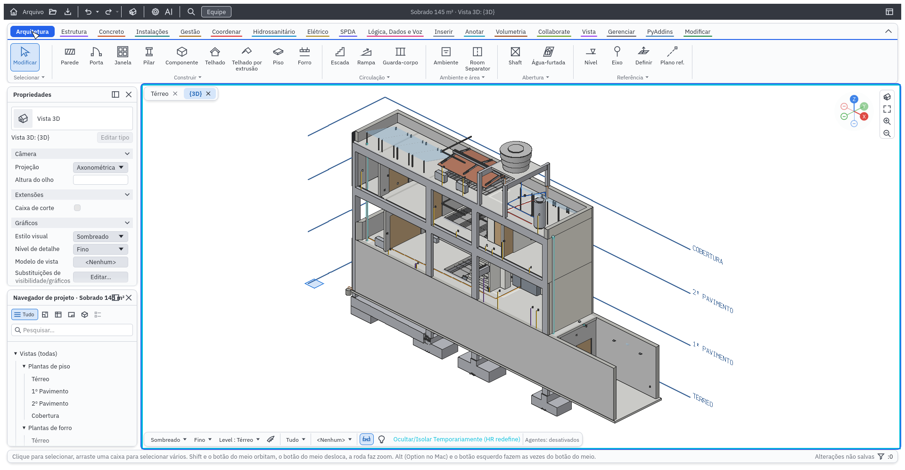

- **Construir**: walls (compound layers, curtain walls), doors and windows, columns, components
  (furniture, fixtures, equipment), roofs by footprint and by extrusion, floors and ceilings.
- **Circulação**: stairs, ramps and railings.
- **Ambiente e área**: rooms (name, number, area, perimeter) and room separators.
- **Abertura**: shafts through several floors and dormers.
- **Referência**: levels, grids, the work plane and reference planes.

### Estrutura (Structure)

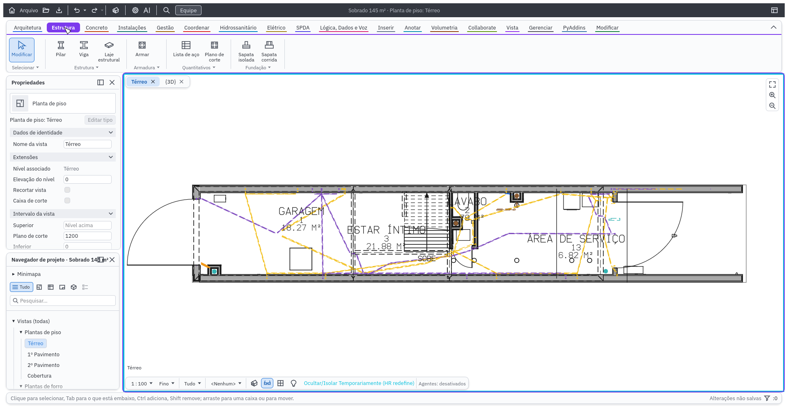

- **Estrutura**: structural columns, beams and structural slabs.
- **Armadura**: bars by rules for beams, columns, footings and floors (**Armar**).
- **Quantitativos**: the steel list and the cut plan.
- **Fundação**: isolated and strip footings.

### Concreto (Concrete)

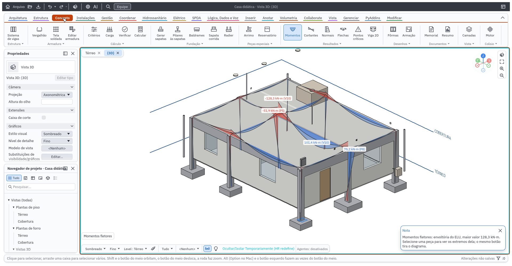

- **Estrutura**: **Sistema de vigas** — the beams on the selected slabs, laid out by the project's criteria.
- **Armadura**: **Vergalhão** and **Tela soldada** placed by hand, and **Editar armadura** for each piece.
- **Cálculo**: **Critérios** (concrete, covers, loads, soil, wind…), **Carga** (point, line and area loads drawn on the
  plan or put on the pieces), **Verificar** and **Calcular** (analysis and design by NBR 6118).
- **Fundação**: **Gerar sapatas** from the analysis, **Pilares às sapatas**, **Baldrames**, **Sapata corrida** and
  **Radier**.
- **Peças especiais**: **Arrimo** (retaining walls) and **Reservatório** (water tanks), made from the walls you drew.
- **Resultados**: **Momentos**, **Cortantes**, **Normais**, **Flechas** and **Pontos críticos** drawn over the 3D view,
  and **Viga 2D**.
- **Desenhos**: **Fôrmas** and **Armação** — the formwork and reinforcement sheets, in the program's sheets or as PDF.
- **Documentos**: the calculation **Memorial** and its **Resumo**.
- **Camadas** (the view by discipline and by system) and **Motor** (whether the engine answers).

### Instalações (Building systems)

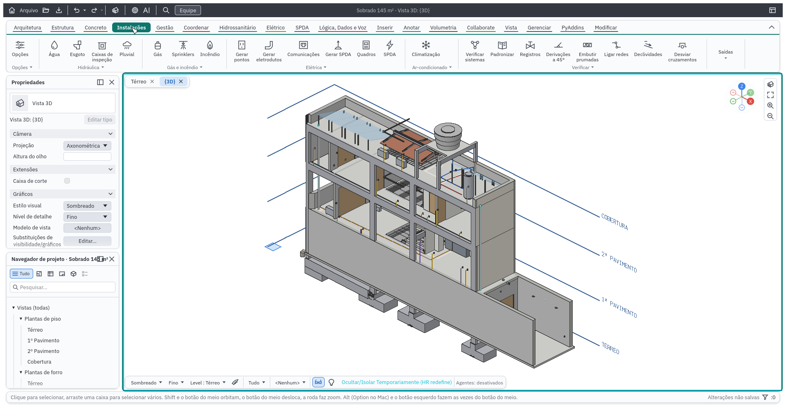

- **Opções**: the project's options for the systems.
- **Hidráulica**: **Água** (cold and hot water, NBR 5626), **Esgoto** (sanitary drains and the septic tank, NBR 8160 and
  7229), **Caixas de inspeção** placed where the standard asks, and **Pluvial** (storm water, NBR 10844).
- **Gás e incêndio**: **Gás**, **Sprinklers** and **Incêndio** (fire protection).
- **Elétrica**: **Gerar pontos** and **Gerar eletrodutos** (the engine lays them out by NBR 5410), **Comunicações**,
  **Gerar SPDA** and **SPDA** (lightning protection, NBR 5419), and **Quadros** (panels and circuits).
- **Ar-condicionado**: **Climatização**.
- **Verificar**: **Verificar sistemas**, **Padronizar** (market pipe types), **Registros**, **Derivações a 45°**,
  **Embutir prumadas** (risers into the walls), **Ligar redes**, **Declividades**, **Desviar cruzamentos**, holes
  through beams, applying the calculated sizes, and drawing or removing the fittings.
- **Saídas**: memorials, the list of materials and fittings, and the system sheets (in the program or as PDF).

### Gestão (Management)

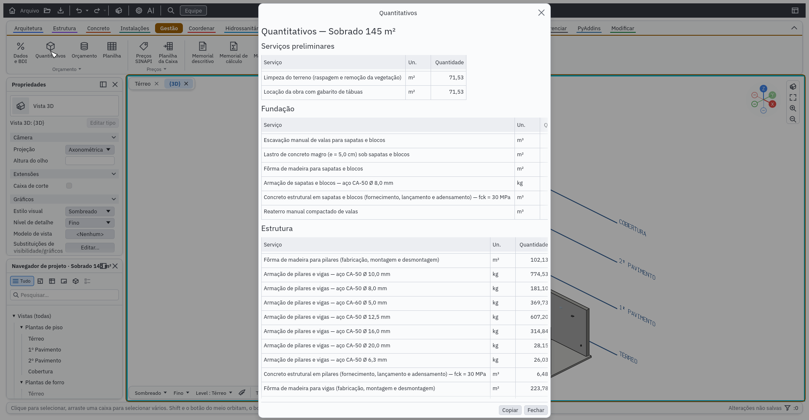

- **Orçamento**: **Dados e BDI**, **Quantitativos** measured in the model, **Orçamento** and the budget **Planilha**.
- **Preços**: **Preços SINAPI** (the state's price base) and the official **Planilha da Caixa**.
- **Documentos**: **Memorial descritivo**, **Memorial de cálculo**, **Materiais**, **Acessibilidade** (NBR 9050),
  **Áreas mínimas** and **Desempenho** (NBR 15575).
- **Normas**: the standards the project follows, and **Normas do Brasil** to apply them.
- **Ajuda**: **Aprender a projetar**.

### Coordenar (Coordinate)

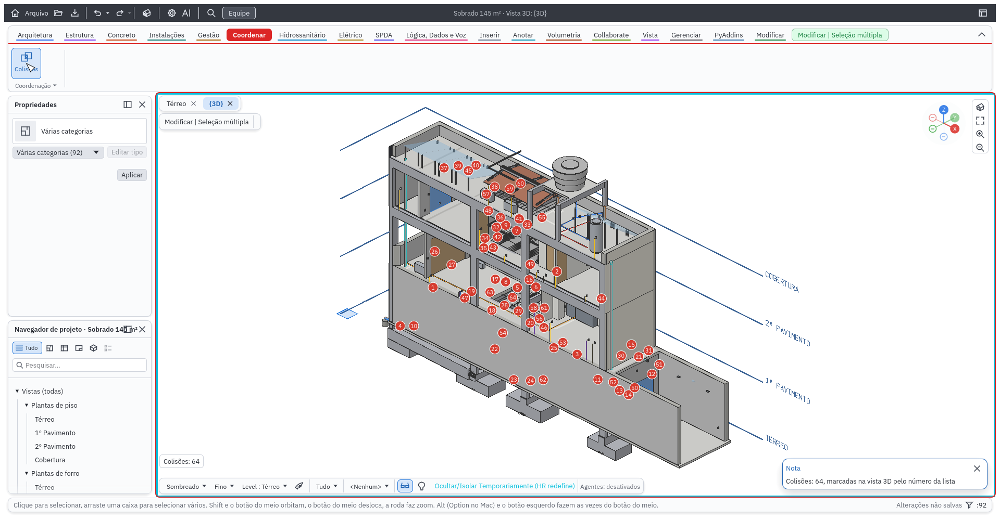

- **Colisões**: the systems against the structure, the architecture and each other. Each clash is numbered over the 3D
  view and listed; runs embedded in walls and slabs, and runs through the holes of a beam, are counted apart.

### Hidrossanitário (Plumbing)

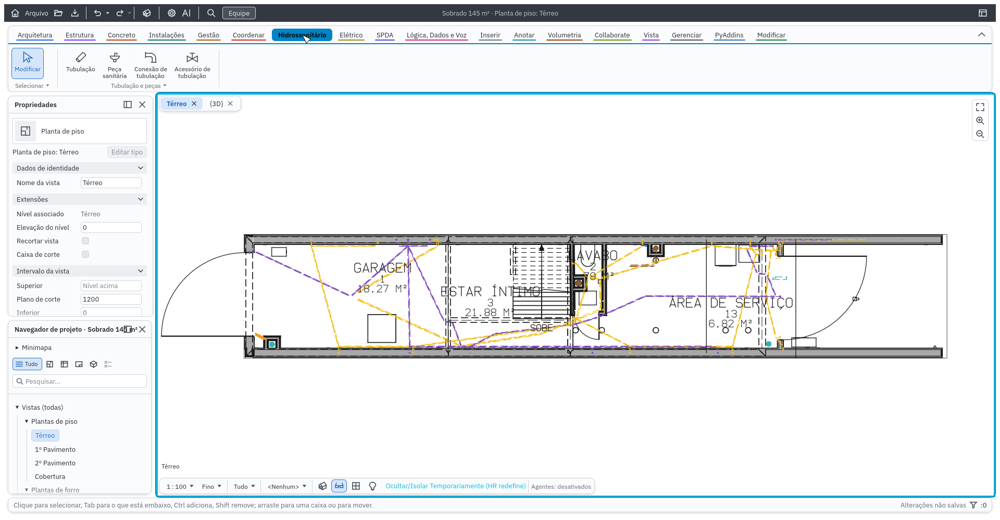

- **Tubulação e peças**: pipes, plumbing fixtures, pipe fittings and pipe accessories, drawn in Colisio's systems.

### Elétrico (Electrical)

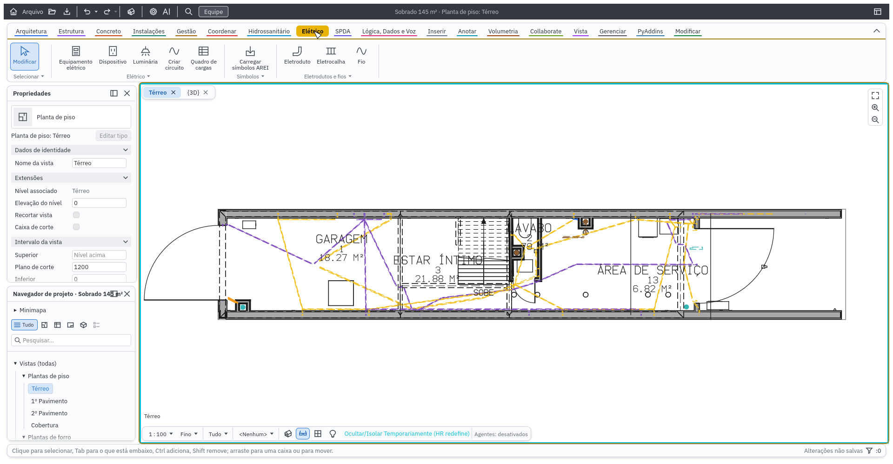

- **Elétrico**: electrical equipment, devices, lighting fixtures, circuits and the panel schedule.
- **Símbolos**: plan symbols loaded as families.
- **Eletrodutos e fios**: conduits, cable trays and wires.

### SPDA (Lightning protection)

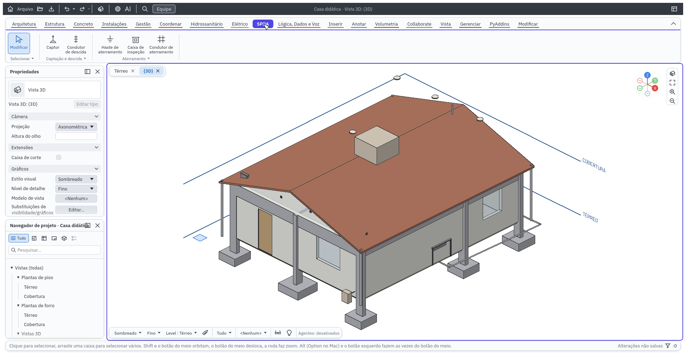

- **Captação e descida**: air terminals and down conductors.
- **Aterramento**: ground rods, inspection boxes and ground conductors.

### Lógica, Dados e Voz (Data and voice)

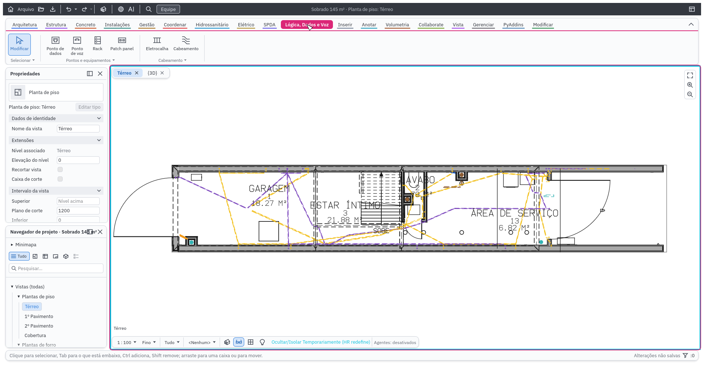

- **Pontos e equipamentos**: data and voice outlets, racks and patch panels.
- **Cabeamento**: cable trays and cabling.

### Inserir (Insert)

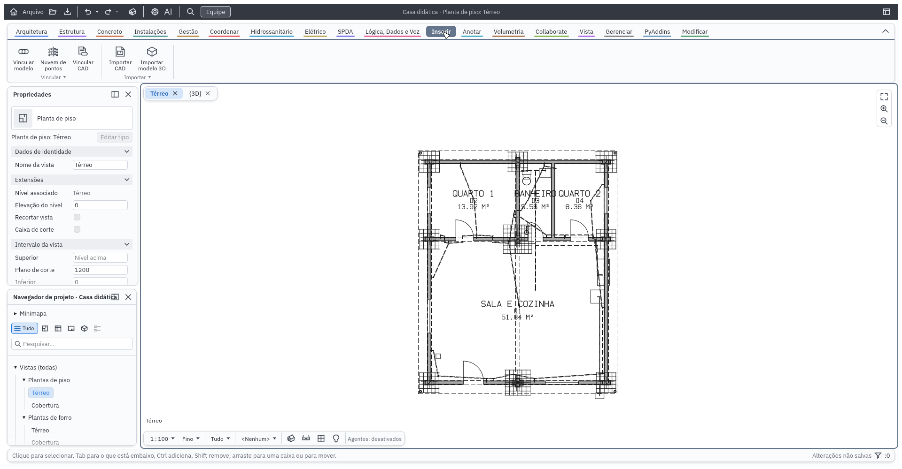

- **Vincular**: link another project, a point cloud, or a CAD drawing.
- **Importar**: import a CAD drawing (DWG, DXF) or a 3D model (OBJ, glTF) as a family.

### Anotar (Annotate)

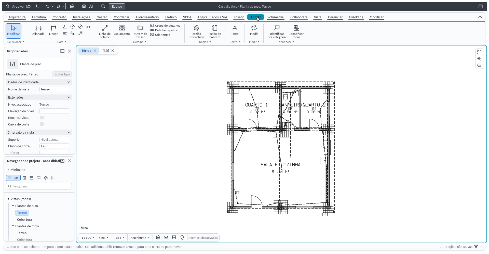

- **Cota**: aligned, linear, angular, radial, diameter and arc-length dimensions, spot elevations and coordinates.
- **Detalhe**: detail lines, insulation, revision clouds, detail groups and repeating details.
- **Região**: filled and masking regions. **Texto**, **Medir**, and tags by category or for everything.

### Volumetria (Massing)

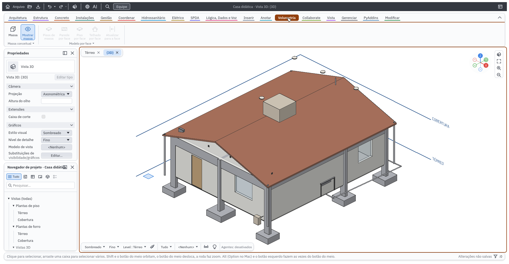

- **Massa conceitual**: masses and showing them.
- **Modelo por face**: mass floors, and walls, floors and roofs made on a mass's faces, updated when it changes.

### Collaborate

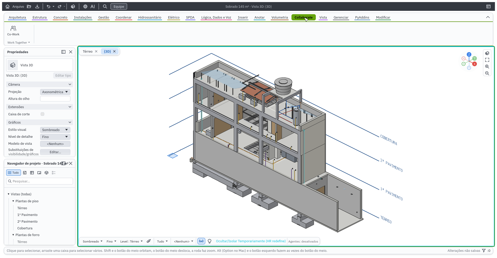

- **Co-Work**: work on the same project with other people on the network (see [Teamwork](#teamwork)).

### Vista (View)

- **Gráficos**: Visibility/Graphics, filters, view templates, thin lines and the dark canvas.
- **Criar**: crop, 3D views, duplicate views, sections, elevations, cameras and schedules.
- **Composição de folha**: sheets, title blocks and placing views on them.
- **Janelas**: close inactive views, the interface's palettes, and the **Publisher** (PDF and other formats in sets).

### Gerenciar (Manage)

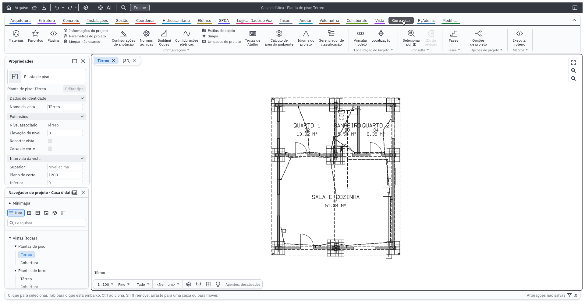

- **Materiais**, **Favoritos** and **Plugins**.
- **Configurações**: project information and parameters, purge unused, annotation settings, technical standards, building
  codes, electrical settings, object styles, snaps, project units, keyboard shortcuts, room area calculation, the
  project's language and the classification manager.
- **Localização do projeto**: link a model, and the project's location (base point, survey point, shared coordinates).
- **Consulta**: select by ID and the IDs of the selection. **Fases**, **Opções de projeto** and **Executar roteiro**.

### PyAddins

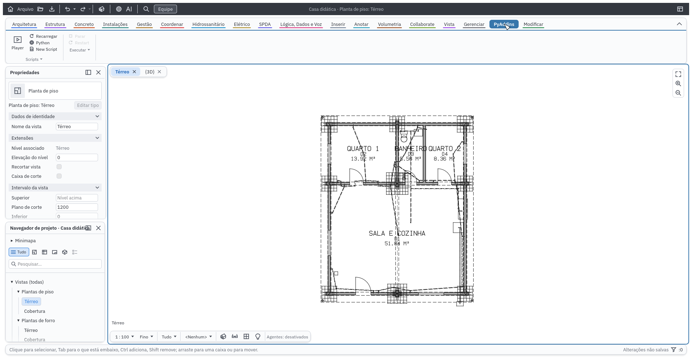

- **Scripts**: the Player, **Recarregar**, **Python** and **New Script**. **Executar**: stop and restart.

### Modificar (Modify)

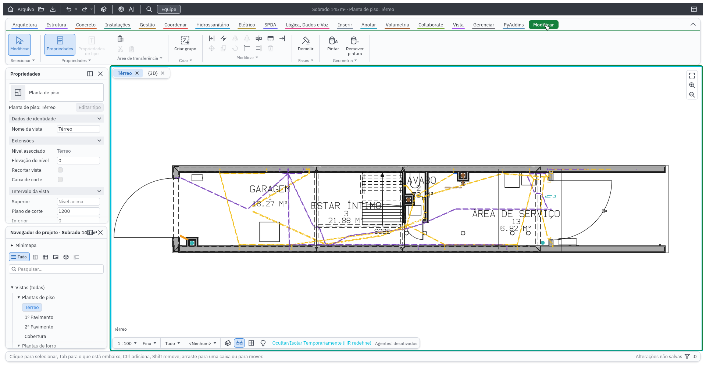

- **Selecionar** and **Filtro**; **Propriedades** and type properties; the clipboard; **Criar grupo**.
- **Vista**: hide elements or categories, and override graphics.
- **Modificar**: align, split, mirror, move, copy, rotate, trim and extend, array and delete.
- **Demolir** (phases), **Pintar** and **Remover pintura** (a face's material).

---

## File formats

| | Open / import | Save / export |
|---|---|---|
| Project | `.colisio` (also `.bimc`), templates | `.colisio` (with a recovery copy), templates |
| BIM | IFC (open), Revit `.rvt`, other projects linked | IFC4, IFC2x3 |
| CAD | DWG, DXF (import or link, underlay) | DWG, DXF |
| Documents and pictures | — | PDF (vector), SVG, PNG, JPG, JPEG XL |
| 3D | OBJ and glTF as families | glTF (`.glb`), OBJ, STL |
| Survey | point clouds PTS, XYZ, PLY, LAS, E57 | — |
| Data | SINAPI price base, the official SINAPI workbook (XLSX) | schedules and budget (XLSX, ODS, CSV), BCF |

## Standards

Colisio designs and checks by the Brazilian ABNT standards, among them: **structures** NBR 6118, 6120, 6122 and 6123;
**building systems** NBR 5626, 8160, 7229, 10844, 15526, 10897, 5410, 5419, 14565 and 16401; **architecture and
performance** NBR 9050 and 15575. A new project starts under the Brazilian standards (**Gestão → Normas do Brasil**).

All results are design aids and **must be checked by a licensed professional**.

## Projects of Colisio 1.9

Colisio 1.0 does not open projects of Colisio 1.9, the earlier program: they go on in Colisio 1.9, which stays available
in **[release 1.9.76](https://github.com/Colisio-BIM/Colisio/releases/tag/v1.9.76)**. When Colisio 1.9 is installed on
the same computer, a project of it opened in Colisio 1.0 is handed to it. A project saved by Colisio 1.0 does not open in
Colisio 1.9.

## AI assistants and scripts

- **MCP server.** An assistant such as Claude or Codex can read, build and check the project open in the window, with
  every command of the program and every Colisio calculation as its tools: **File → Settings → Agents** opens the
  agents' port, on this computer only, and shows the command to give the assistant. Agents can also be allowed only to
  read.
- **AI chat.** The Assistant palette talks about the open project with the provider you choose, on your own key.
- **Python scripts.** The PyAddins tab runs your own Python scripts on the model.

## Teamwork

**Collaborate → Co-Work** lets several people work on the same project at once over the local network: the host shares
a join code, guests join with it, every change reaches everyone, and each person undoes their own edits. No server is
needed.

## Try it with the teaching house

**Gestão → Ajuda → Aprender a projetar → Aprender com um exemplo** opens the teaching house at the start of a track, or
complete — architecture, structure and every system — to study and calculate.

---

## License, third-party software and trademarks

Colisio is proprietary software: you may download, install and use it, including professionally — see the
[license](LICENSE). This repository holds only the installers; the source code is not public.

The program includes open-source components under their own licenses (MIT, Apache-2.0, the SIL Open Font License,
Node.js's license and others). Their notices and license texts are installed with it, in its folder: `NOTICE`,
`LICENSE-MIT`, `LICENSE-APACHE`, `fonts\…\OFL.txt` and `motor\node-LICENSE.txt`.

Revit and AutoCAD are trademarks of Autodesk, Inc.; SINAPI is maintained by Caixa Econômica Federal and IBGE; Node.js is a
trademark of the OpenJS Foundation. Colisio is not affiliated with them; their names are used only to describe
compatibility.
